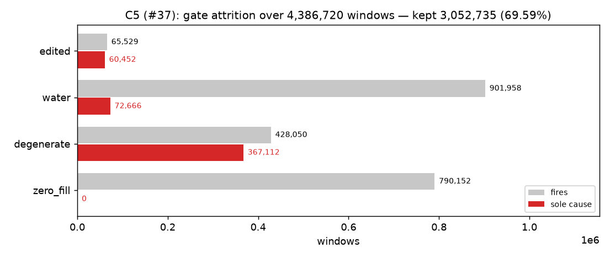
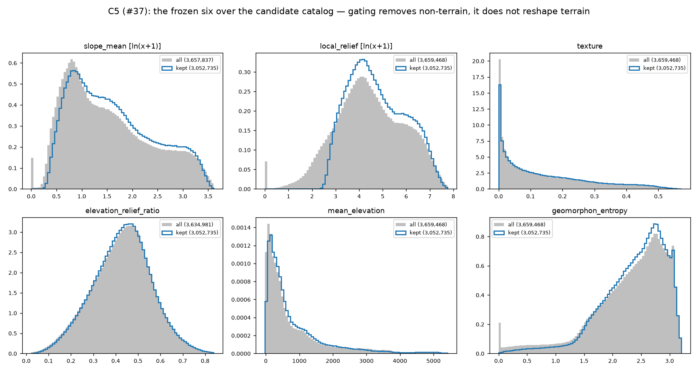
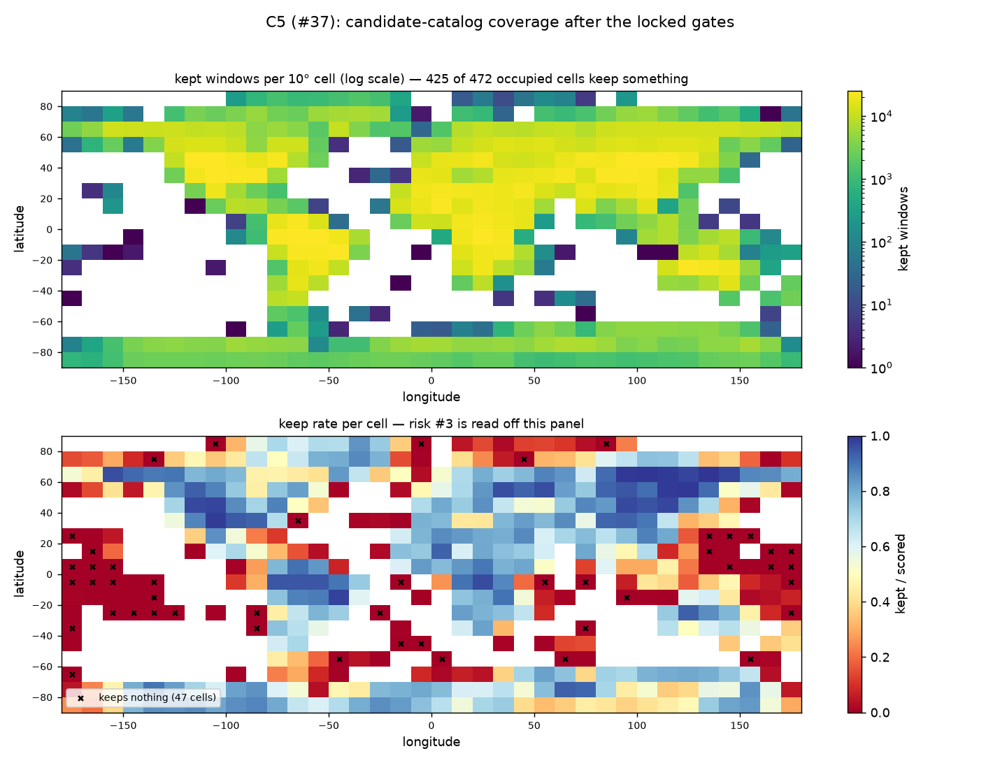

# The candidate catalog — Phase C's Definition of Done

Resolves issue [#37](https://github.com/JStoschek/DEMAE/issues/37) (Phase-C map,
[#32](https://github.com/JStoschek/DEMAE/issues/32)) and closes Phase C. C3
([#35](https://github.com/JStoschek/DEMAE/issues/35)) scored the frame; C4
([#36](https://github.com/JStoschek/DEMAE/issues/36),
[`gate-attrition.md`](gate-attrition.md)) locked the thresholds; this applies them as
**filter columns**, persists the result, and reports the three things the map's
Definition of Done asks for: global metric distributions, gate-attrition counts, and a
coverage map.

Produced by [`notebooks/c5_catalog_summary.py`](../../notebooks/c5_catalog_summary.py)
over `data/catalog_gated/` (`python -m dataset.gates`, derived from `data/catalog/`,
`code_version` `ad46e96`). Every number here is in
[`c5-catalog-summary.json`](c5-catalog-summary.json); no sampling anywhere, the whole
4.39 M-row frame.

Copyright / attribution (mask spec §5, Art. 6(b)): *produced using Copernicus
WorldDEM-30 © DLR e.V. 2010-2014 and © Airbus Defence and Space GmbH 2014-2018 provided
under COPERNICUS by the European Union and ESA; all rights reserved.*

## 1. What is on disk

| | |
|---|---|
| raw catalog | `data/catalog/` — 4,386,720 rows × 22 columns, 26,450 COGs, ungated |
| **gated catalog** | `data/catalog_gated/` — the same 4,386,720 rows × **30** columns |
| added | 8 boolean columns: `zero_fill`, `degenerate`, `water`, `edited`, `masks_missing`, `keep`, `water_affected`, `coastline` |
| kept | **3,052,735 (69.59%)** — the sampling frame Phase D draws from |
| cost to rebuild | seconds (`python -m dataset.gates`); no COG is re-read |

**No row and no column is removed.** `keep` is a convenience over the four drop gates,
not a filtered frame — which is what makes a threshold re-tunable by re-running one
command instead of the six-hour global pass. Neither directory is in git (~190 MB of
Parquet each); both rebuild from the two commands in the notebook's header.

`data/catalog_gated/catalog_meta.json` records the locked thresholds, the attrition
table, and the raw catalog's own fingerprint under `source_catalog`, so the gated frame
names the scoring run it derives from.

## 2. Gate attrition — C4's table, recomputed from the shipped columns

| gate | predicate | fires | sole cause |
|---|---|---|---|
| `zero_fill` | `exact_zero_frac >= 0.75` | 790,152 | **0** |
| `degenerate` | `land_std < 3.0` | 428,050 | 367,112 |
| `water` | `wbm_water_frac > 0.30` | 901,958 | 72,666 |
| `edited` | `edm_edited_frac > 0.25 \| flm_fill_frac > 0.25` | 65,529 | 60,452 |

**Every count reproduces [`gate-attrition.md`](gate-attrition.md) exactly**, including
the per-band table (§3.4) and the derived tags — `water_affected` 159,011 and
`coastline` 40,815 over the kept frame. That is the check worth having: C4's analysis
and this implementation are separate code paths over the same frame, and they agree to
the window. `zero_fill`'s empty sole-cause bar is C4's headline finding — it is inert at
these settings and retained as the one ocean test that does not trust WBM.

| band | windows | keep |
|---|---|---|
| 0–50 | 3,036,416 | 69.27% |
| 50–60 | 393,440 | 76.25% |
| 60–70 | 458,496 | 75.98% |
| 70–80 | 364,160 | 60.58% |
| 80–85 | 105,408 | 64.51% |
| 85–90 | 28,800 | **43.58%** |

### 2.1 One thing this pass added to C4's arithmetic: `masks_missing`

`NaN > 0.30` is `False`, so a window whose masks could not be read would clear the water
and edited caps *without either having been evaluated*. Those windows are flagged
`masks_missing` and excluded from `keep`. **The shipped catalog has zero of them** — C3's
two anomalies were whole-COG read failures, and an unmarked COG is re-scanned rather
than half-written — so this changes no count C4 published. It exists so a future run
cannot quietly seed Phase D's frame with unknown-quality windows.

A NaN `land_std` is a different animal and is **not** missing data: it means the window
has no land pixel, which is why `degenerate` cannot fire on an ocean window (C4 §1).

## 3. Global metric distributions

The frozen six at ADR-0004's transforms (`ln(x+1)` on `slope_mean` and `local_relief`),
whole frame behind, kept sub-frame in front, both area-normalised — the kept frame is
30% smaller by construction, and a count plot would show that gap in every panel and
nothing else. What the reader is checking is a **shape** change.

| metric | all: median | kept: p05 | kept: median | kept: p95 |
|---|---|---|---|---|
| `slope_mean` | 2.899 | 0.733 | 3.405 | 21.819 |
| `local_relief` | 78.633 | 19.344 | 97.831 | 919.886 |
| `texture` | 0.091 | 0.002 | 0.105 | 0.432 |
| `elevation_relief_ratio` | 0.434 | 0.206 | 0.434 | 0.640 |
| `mean_elevation` | 415.413 | 49.004 | 462.985 | 2,818.298 |
| `geomorphon_entropy` | 2.437 | 1.337 | 2.474 | 3.059 |

**The gates remove a spike, not a mode.** Every panel shows the same story: a spike at
zero in the ungated frame (flat, water-covered, no-signal windows) that gating deletes,
leaving the rest of the distribution intact — `elevation_relief_ratio`, which has no such
spike, has an *identical* median before and after. The kept distributions shift mildly
rugged-ward, which is the gates doing exactly what they are for. Nothing is truncated:
the kept frame still runs from p05 `slope_mean` 0.73° to p95 21.8°, and 26.99% of kept
windows sit at `land_std` 3–10 m (C4 §3.2). Flat terrain is abundantly represented; what
is gone is *no-terrain*.

## 4. Coverage

| | |
|---|---|
| 10° cells occupied | 472 |
| 10° cells keeping ≥1 window | **425** (47 hollow) |
| COGs scored | 26,450 |
| COGs keeping ≥1 window | **24,118** (median 122 kept windows each) |

The 47 hollow cells are C4 §4's, unchanged: **all are ≥95% `zero_fill` atoll and
open-water cells** — Marshall Islands, Micronesia, Tuvalu, French Polynesia, Seychelles.
A 1° COG exists there because a speck of land sits in it, and at 224 px (6.7 km) every
window is ≥75% sea. That is the ocean gate removing ocean, not a cap hollowing a terrain
family; risk #3 stays clear.

The upper panel's continents are recognisable, which is the cheapest possible check that
the geography columns are not scrambled. The lower panel is where a hollowing would show
— dark on *both* panels rather than just the left.

## 5. Invariants Phase D would otherwise discover the hard way

| check | result |
|---|---|
| unique `window_id` | 4,386,720 / 4,386,720 |
| rows match the raw catalog | yes — gating added no row and lost none |
| kept windows with a NaN metric | **0** |
| kept windows with `masks_missing` | 0 |

The third is the one that matters: Phase D stratifies on the frozen six, and k-means
cannot take a NaN row. 752,463 windows (17.2%) carry at least one NaN metric — 727,252
of them have no land pixel at all, and the remainder are land specks in water whose
`local_relief` is exactly 0 (making `elevation_relief_ratio` 0/0) or whose slope is
undefined.

**None of them survives, and not only because of the water cap.** Every NaN-metric
window is caught by `zero_fill`, `degenerate` or `edited` as well — 0 of the 752,463 is
water-only. So the invariant does not rest on the gate C4 flagged as the fragile one
(WBM, the mask that calls a 3,656 m salt flat water); it would hold with the water cap
switched off entirely. It is still a *measurement* rather than a proof, and a threshold
that moves should re-run this notebook.

## 6. What this hands forward

- **Phase C is complete.** The candidate catalog is on disk as its Definition of Done
  describes it, the gates are re-runnable filter columns over stored fractions, and the
  three ADR-0004 parked decisions (read pricing, the WBM ocean test, gate thresholds)
  are all closed.
- **Phase D inherits a 3,052,735-window sampling frame** with `water_affected` on
  159,011 kept windows and a 40,815-window coastline stratum, spread over 24,118 COGs
  and 425 geo-cells, every metric finite.
- **Any threshold can still move.** Edit the constants in
  [`src/dataset/gates.py`](../../src/dataset/gates.py), re-run `python -m dataset.gates`
  and this notebook, and amend [`gate-attrition.md`](gate-attrition.md) — the raw frame
  is untouched, so no re-scoring is involved. Two gates (`zero_fill`, `flm_fill_frac`)
  are inert backstops and should not be read as tuned values.
