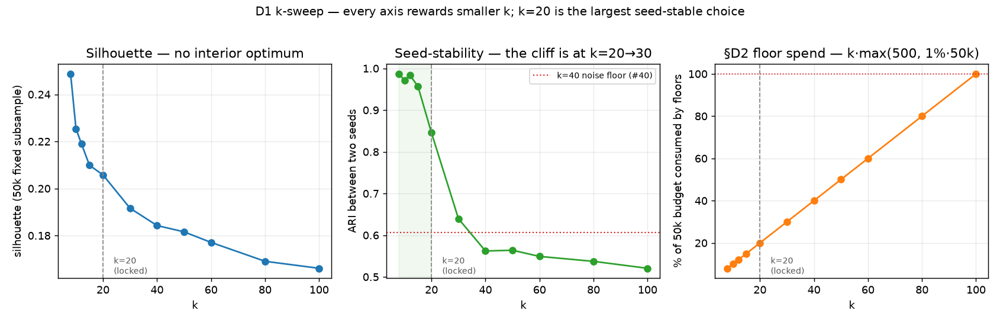

# Choosing k by measurement — and pricing what the floor costs at each k

Resolves issue [#41](https://github.com/JStoschek/DEMAE/issues/41) (Phase-D map,
[#39](https://github.com/JStoschek/DEMAE/issues/39)). Plan §D1 carried **k = 40** as a
knob — the 15/40 figure is Iwahashi's published global-lineage precedent, not a
measurement on *this* frame. This is that measurement. It sweeps k over the frame
[#40](https://github.com/JStoschek/DEMAE/issues/40) fixed, prices the §D2 floor at each
k, and **locks k = 20**, retiring the plan's precedent figure on the evidence.

Artifacts: [`artifacts/phase_d/centroids.json`](../../artifacts/phase_d/centroids.json)
(the shipped fit), produced by `python -m dataset.centroids`. Code:
[`src/dataset/centroids.py`](../../src/dataset/centroids.py). Sweep harness (throwaway):
[`prototypes/d1_k_sweep_proto.py`](../../prototypes/d1_k_sweep_proto.py).

Copyright / attribution (mask spec §5, Art. 6(b)): *produced using Copernicus WorldDEM-30
© DLR e.V. 2010-2014 and © Airbus Defence and Space GmbH 2014-2018 provided under
COPERNICUS by the European Union and ESA; all rights reserved.*

## 1. Method

The frame is exactly [#40](https://github.com/JStoschek/DEMAE/issues/40)'s: all
**3,052,735** kept rows, all six ADR-0004 metrics, both `water_affected` and `coastline`
inside the fit, standardized by the **committed** scaler
([`artifacts/phase_d/scaler.json`](../../artifacts/phase_d/scaler.json)) — not a
re-fitted one, so the sweep describes the same space Phase F will. Fits are scikit-learn
`KMeans`, full-batch Lloyd, float32, `n_init = 10`, three seeds `{0,1,2}` per k.

Per k it reports:

- **silhouette** on a **fixed 50k subsample** chosen by keyed BLAKE2b of `window_id` (the
  full 3.05 M × 3.05 M pairwise is neither the ask nor feasible; the hash keeps the
  subsample identical on every machine, so no RNG enters a reported number);
- **inertia**, mean and best-of-three, with the seed **spread** — because #40 showed two
  k=40 fits landing 0.06% apart in inertia while agreeing on ~61% of pairs, an elbow
  drawn on differences smaller than that spread is drawing noise;
- **occupancy** — the N_h distribution and the rarest stratum's N_h;
- **seed-stability** — adjusted Rand index (ARI) between the three independent fits;
- **floor spend** — `k · max(500, 1% of 50k)` as a share of the 50k debug budget.

## 2. The sweep

| k | silhouette | ARI (seeds) | inertia (best) | inertia spread | N_h min | N_h max | spread | floor % of budget |
|---:|---:|---:|---:|---:|---:|---:|---:|---:|
| 8 | **0.249** | 0.987 | 5,883,181 | — | 112,768 | 756,108 | 6.7× | 8% |
| 10 | 0.225 | 0.971 | 5,135,652 | — | 83,765 | 540,483 | 6.5× | 10% |
| 12 | 0.219 | 0.984 | 4,658,102 | — | 84,084 | 461,142 | 5.5× | 12% |
| 15 | 0.210 | 0.957 | 4,169,270 | — | 70,639 | 391,912 | 5.5× | 15% |
| **20** | **0.206** | **0.846** | **3,596,294** | **0.20%** | **32,075** | **291,129** | **9.1×** | **20%** |
| 30 | 0.192 | 0.639 | 2,935,637 | 0.14% | 29,183 | 222,110 | 7.6× | 30% |
| 40 | 0.184 | 0.562 | 2,546,020 | 0.11% | 26,984 | 157,508 | 5.8× | 40% |
| 50 | 0.182 | 0.564 | 2,292,969 | — | 17,499 | 123,128 | 7.0× | 50% |
| 60 | 0.177 | 0.549 | 2,101,221 | — | 16,796 | 98,722 | 5.9× | 60% |
| 80 | 0.169 | 0.537 | 1,843,671 | — | 13,062 | 79,413 | 6.1× | 80% |
| 100 | 0.166 | 0.521 | 1,669,764 | — | 7,109 | 69,438 | 9.8× | 100% |

Three readings, in order of weight:

**There is no interior optimum — silhouette cannot pick k.** Silhouette rises
monotonically as k *shrinks*, all the way to k=8, the smallest tested; it never turns
over. Inertia falls smoothly with no elbow, and every neighbour-to-neighbour inertia
gap dwarfs the ~0.1–0.2% seed spread, so the elbow test simply does not fire. Both are
the signature of a **continuum**, not clusters: the six-dimensional descriptor cloud has
no natural clump count, so a clustering-quality curve has no k to hand back. k is a
*resolution* choice, not a discovery.

**The one measured boundary is a seed-stability cliff at k = 20 → 30.** Two independent
fits agree at **ARI 0.846 at k=20** but drop to **0.639 at k=30** — through #40's
own 0.607 noise floor. At k ≤ 20 the partition reproduces across seeds; at k ≥ 30 it is
substantially a coin-flip. Since quality and cost both reward small k and only *terrain
resolution* pushes k up, the rational pick is **the largest k whose strata still
reproduce** — the most resolution obtainable before the strata dissolve into seed noise.
That is **k = 20**.

**The floor coupling seals it.** §D2's per-stratum floor is `max(500, 1% of budget)`, so
floor spend is a flat `k × 1%` of budget at any budget above 50k. At the incumbent k=40
that is **40% of the budget gone to floors** before Neyman allocates a window; the three
~5% boost pools take another ~15%, leaving Neyman ~45%. At **k=20 floors cost 20%**,
handing the variance-proportional rule (#42) its dynamic range back. k=80 — floors at
80% — degenerates the sampler into "equal quotas plus boosts", exactly the design
ADR-0004 superseded, and it does not even buy cluster quality to trade against (silhouette
0.169, the worst in the table).

**k = 40, the plan's precedent, is dominated on every measured axis:** worse silhouette,
seed-unstable, and twice k=20's floor cost. It is retired here — an amendment to plan §D1
under the map's standing preference that measurement may redraw §D.

### Why not go smaller (k = 8–15)?

They score marginally higher on silhouette and stability and cost less in floors — but
each is a *coarser* partition. k=8's rarest stratum is 112k rows: a bucket that broad is
internally heterogeneous in the very descriptors the design rests on, and it hands
Phase E2's 12-tiles-per-stratum gallery too few, too-mixed strata to judge
terrain-meaningfulness against. k=20 keeps 20 legible terrain strata, each still ≥32k
rows deep, while staying inside the reproducible band. Resolution is the reason to spend
the k; k=20 spends as much as the stability cliff allows and no more.

## 3. Implementation — decided by measurement, not assumed

### 3.1 Lloyd, not MiniBatch

The ticket flagged full Lloyd vs MiniBatch as a real choice at 3.05 M × 6. Priced at
k=20, three seeds each:

| algorithm | inertia (range) | ARI between seeds | seconds/fit |
|---|---|---:|---:|
| Lloyd (full batch) | 3,596,296 – 3,603,538 | **0.940** | 40–53 |
| MiniBatch (batch 8192) | 3,658,485 – 3,739,972 | **0.506** | 17–28 |

MiniBatch is ~2–4% worse on inertia, and its seed-stability **collapses to 0.51** — barely
above full Lloyd at k=40, and a cross-algorithm ARI of only 0.50 says the two do not even
find the same strata. It is ~2× faster, but a full-frame Lloyd fit is ~45 s at `n_init=10`
and ~2 min at `n_init=25`; nothing here needs the speed, and it would be bought by
sacrificing the reproducibility the whole map protects. **Lloyd, `n_init = 25`** for the
shipped fit — restarts are the lever against the multi-modality #40 found, and they are
affordable, so the shipped fit is not the stingy one. It landed at inertia **3,596,296**,
matching the best of the sweep's k=20 fits: `n_init=25` found the global-best partition.

### 3.2 Determinism is met by persisting the centroids, not by seeding the fit

Measured at k=20, sorting centroids to match them across runs:

| comparison | bitwise identical? | max centroid coord diff |
|---|---|---:|
| same seed, same thread count, two runs | no | 4.1 × 10⁻⁵ |
| same seed, 8-thread vs 1-thread | no | 1.9 × 10⁻⁴ |

The fit is **not** bitwise-reproducible: float32 Lloyd folds thread-reduction order into
the result, so a re-fit cannot be the contract. The **committed centroids are the
contract**, exactly as #40 warned and exactly as the scaler works.
[`centroids.assign`](../../src/dataset/centroids.py) is a pure `argmin` of squared
Euclidean distance with a deterministic tie-break (lowest stratum index), so *assignment
from the committed artifact reproduces bitwise*. Demonstrated over the full frame:
labelling all 3,052,735 rows under 1 thread vs 8 threads gives **0 disagreeing rows**.
The map's determinism bar — the selection reproduces for the life of the project — is met
by persisting `centroids.json`, not by seeding.

The artifact carries the same **frame fingerprint** as the scaler (`n_kept`,
`gate_thresholds`, `catalog_code_version`) and its sklearn version (`1.9.0`);
`read_centroids(..., fingerprint=...)` refuses a moved frame rather than silently
producing a plausible, wrong partition. `scikit-learn` is now a **pinned runtime
dependency** (`>=1.9,<1.10`), moved out of the dev group — the read/`assign` path is pure
NumPy, but a re-fit must use the pinned minor.

## 4. The shipped fit

`artifacts/phase_d/centroids.json`: k=20, Lloyd, `n_init=25`, sklearn 1.9.0, inertia
3,596,296 (243 iters). Occupancy over the full frame:

| | N_h |
|---|---:|
| rarest stratum (id 6) | 32,229 |
| median stratum | 149,750 |
| largest stratum | 292,363 |
| spread | 9.1× |

The rarest stratum holds 32,229 rows — 64× the 500-row absolute floor and 3× the
0.5% (250-row) per-stratum draw a flat allocation would give it — so **no stratum is
degenerate or near-empty at k=20**, and the merge/split question the map parked in *Not
yet specified* does not arise for this fit.

## 5. What this hands forward

- **[#42](https://github.com/JStoschek/DEMAE/issues/42) (allocation)** — inherits **k=20**
  and its occupancy: 20 strata, N_h 32k–292k (9.1× spread), floors costing a fixed 20% of
  any budget, Neyman with ~65% to vary after the ~15% boost pools. The rarest-stratum
  boost pool (§D2b) targets stratum 6. Still owes the minimum coastline count #40 handed
  it, and now against a *known* stratum count.
- **[#44](https://github.com/JStoschek/DEMAE/issues/44) (sampler)** — assigns rows to
  strata via `centroids.assign` against the committed artifact; must not re-fit. The
  `scikit-learn` runtime pin #40 flagged as owed is **done here**; retiring the ADR-0001
  `stratify.py` remains #44's.
- **Phase F** — re-runs Phase D at 200–500k against *this* `centroids.json` and
  `scaler.json`, both fingerprint-guarded, so the tiers share identical strata. The
  20-stratum, 20%-floor structure holds unchanged at any budget above 50k.
- **The merge/split rule** (map *Not yet specified*) — not needed for the k=20 fit; no
  stratum is degenerate. It can be closed unless a future re-fit surfaces one.
