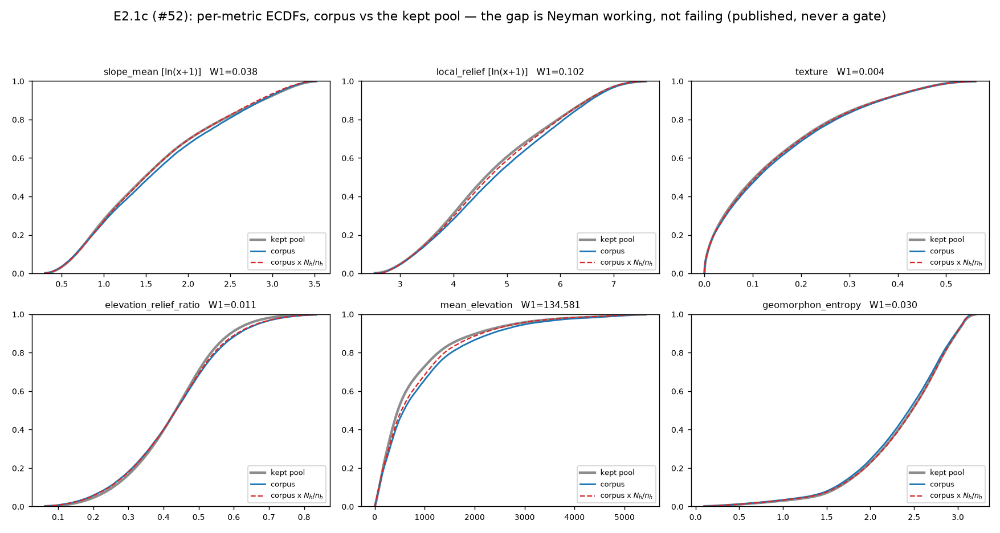
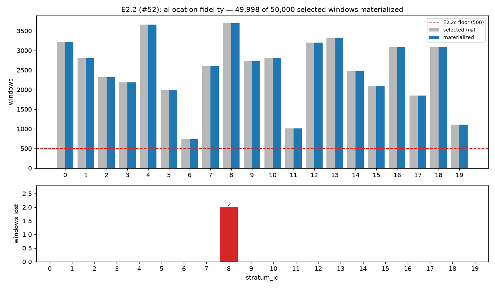
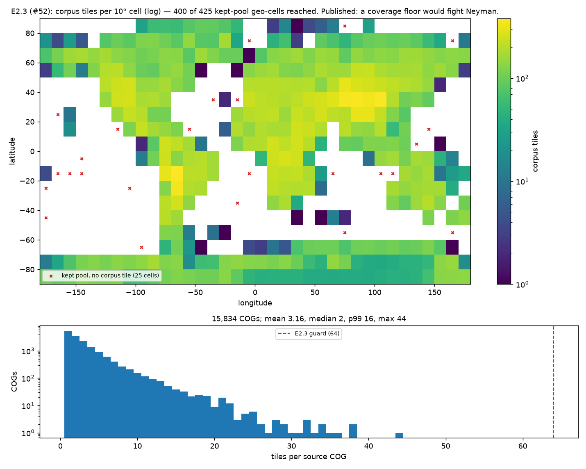
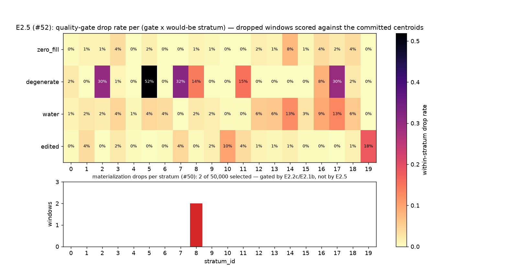

# E2 — the quantitative validation report

Resolves issue [#52](https://github.com/JStoschek/DEMAE/issues/52) (Phase-E map,
[#46](https://github.com/JStoschek/DEMAE/issues/46)). E1
([#51](https://github.com/JStoschek/DEMAE/issues/51)) turned the committed selection
list into shards, a manifest and a ledger; this reads all three back and runs them
against the bar [#47](https://github.com/JStoschek/DEMAE/issues/47) pre-registered in
[`e2-gate-bar.json`](e2-gate-bar.json) **before any of them existed**.

Produced by
[`notebooks/e2_validation_report.py`](../../notebooks/e2_validation_report.py); the
rules it gates on are [`dataset.validate`](../../src/dataset/validate.py), tested in
[`tests/test_validate.py`](../../tests/test_validate.py). Every number here is in
[`e2-validation-report.json`](e2-validation-report.json). No sampling anywhere: the
whole 4.39 M-row catalog, the whole 50,000-row selection list, all 49,998 tiles.

Four of E2's five analyses are here. The fifth — the 12-tiles-per-stratum gallery
(E2.4, [#53](https://github.com/JStoschek/DEMAE/issues/53)) — is a human protocol and
ships separately.

> **This report does not render the verdict.** It reports each criterion against its
> pre-registered threshold and emits the payload for anything that fired. The
> Defect-first / any-Finding-fails roll-up belongs to Gate E
> ([#54](https://github.com/JStoschek/DEMAE/issues/54)).

Copyright / attribution (mask spec §5, Art. 6(b)): *produced using Copernicus
WorldDEM-30 © DLR e.V. 2010-2014 and © Airbus Defence and Space GmbH 2014-2018 provided
under COPERNICUS by the European Union and ESA; all rights reserved.*

## 0. Scoreboard

| criterion | class | gates | result |
|---|---|---|---|
| **E2.1a** metric fidelity | Defect | yes | **pass** — 0 of 49,998 rows differ |
| **E2.1b** drop selectivity | Defect | yes | **pass** — no metric near its null's p99 |
| **E2.1c** pool ECDF | published | no | W1 0.004–134.6; reweighting cuts it 2–4× |
| **E2.2a** selection integrity | Defect | yes | **pass** — md5, 50,000 rows, every n_h, both provenances |
| **E2.2b** materialization counts | Defect | yes | **pass** — no stratum over its allocation |
| **E2.2c** thin stratum | Finding | yes | **pass** — min realized 734; neither limb trips |
| **E2.2d** coastal floor | Finding | yes | **pass** — 1.3381% vs the registered 1.337%, **by one tile** |
| **E2.3** coverage | published | no | 400 of 425 kept-pool geo-cells reached |
| **E2.3** per-COG guard | Defect | yes | **pass** — max 44, cap 64 |
| **E2.5** gate × stratum bias | Finding | yes | **FIRED** — 5 (gate × stratum) pairs |
| **E2.5** baseline sensitivity | published | no | a different 4 pairs — see §5 |

Seven gating criteria pass, one fires. No Defect fired: **the corpus faithfully
implements its committed inputs.** The firing is E2.5, a Finding — a claim about the
design, which is Gate E's to adjudicate, not this report's.

## 1. What was read

| | |
|---|---|
| corpus | `data/corpus_50k/` — 49,998 tiles, `dataset_version` `6fde6a58…`, `code_version` `d043793` |
| ledger | [`artifacts/phase_e/materialization_ledger.parquet`](../../artifacts/phase_e/materialization_ledger.parquet) — 50,000 rows |
| selection list | [`artifacts/phase_d/selection_debug_50k.csv`](../../artifacts/phase_d/selection_debug_50k.csv) — md5 `3936840619…` as loaded |
| gated catalog | `data/catalog_gated/` — 4,386,720 rows, `keep` 3,052,735 |
| allocation | [`d2-allocation-nh.json`](d2-allocation-nh.json) — k=20, n_h 734–3,701 |
| contract | `accept_shortfall` ([#50](https://github.com/JStoschek/DEMAE/issues/50)), read off `corpus_meta.json` |
| E2.1b seed | 52, at the bar's registered 10,000 permutations |

The whole run is ~56 s and zero-network. The catalog and the shards are not in git; the
manifest, the ledger, this report and its figures are.

**Re-runnable per tier.** Nothing here is a 50 k constant: the budget comes from the
selection list's length, the allocation from the committed n_h table, the live contract
from the corpus card, every threshold from the bar, every path from an argument. Phase F
points it at its own artifacts and its own re-registered bar.

## 2. E2.1 — metric distributions



### 2.1a Metric fidelity *(Defect, exact — passes)*

For all **49,998** materialized tiles, the manifest's frozen-metric values equal the
catalog's for the same `window_id`: **0 mismatches on all six metrics**. Both the
catalog and the v2 manifest store the frozen six as float64
([#48](https://github.com/JStoschek/DEMAE/issues/48)), so there is no documented cast to
allow for and the comparison is bitwise. This is the only part of E2.1 that carries
Phase-E information — it says E1's denormalization is a copy, not a recompute.

The join is on `window_id` rebuilt from the manifest's `source_cog`/`win_row0`/`win_col0`
columns rather than by string-splitting `tile_id`, so a COG stem containing an underscore
cannot mis-join silently. A window absent from the catalog is fatal, not a NaN — a
mis-join that produced NaNs would let this criterion pass by comparing nothing.

### 2.1b Drop selectivity *(Defect, blind rule — passes)*

**2 of 50,000** selected windows failed at full res, both `degenerate`, both in stratum
8. Per the bar's rule: per-metric Wasserstein-1 between the dropped and retained sets,
against a null that draws random size-2 subsets from the same 50,000 committed catalog
metrics, 10,000 permutations, fire above the 99th percentile.

| metric | observed W1 | null p99 | fires |
|---|---|---|---|
| `slope_mean` | 4.71 | 14.20 | no |
| `local_relief` | 240.2 | 757.6 | no |
| `texture` | 0.0764 | 0.2631 | no |
| `elevation_relief_ratio` | 0.1154 | 0.2626 | no |
| `mean_elevation` | 938.1 | 2,316.9 | no |
| `geomorphon_entropy` | 0.7191 | 1.1324 | no |

Every observed value sits between a third and a half of its own null's p99. The two
drops are unremarkable against random attrition of the same size.

**The rule was blind and stayed blind.** The null depends only on the drop *count*, never
on which windows dropped, so the threshold above materialized at report time from the
committed catalog alone — nobody calibrated it against the real drops. That is what
[#50](https://github.com/JStoschek/DEMAE/issues/50) bought by pinning a rule instead of a
number.

**Honest about its power.** At D = 2 this test is weak by construction: a two-window
sample cannot be far into the tail of a null built from two-window samples. It is not
evidence that attrition *would* be unbiased at a larger D — it is evidence that this
attrition is not detectably biased, which at two windows is nearly all one can say. Phase
F re-runs the same rule against whatever D it produces, and the rule gets teeth there.

### 2.1c Corpus vs the kept pool *(published, never a gate)*

| metric | W1 corpus vs pool | W1 reweighted (`N_h/n_h`) vs pool |
|---|---|---|
| `slope_mean` [ln] | 0.0381 | 0.0120 |
| `local_relief` [ln] | 0.1021 | 0.0377 |
| `texture` | 0.0042 | 0.0015 |
| `elevation_relief_ratio` | 0.0105 | 0.0083 |
| `mean_elevation` | 134.58 m | 68.67 m |
| `geomorphon_entropy` | 0.0297 | 0.0072 |

The bar is explicit that this can never gate: the corpus is **deliberately** not
pool-distributed. Neyman grants the rarest stratum a 1.8× per-row premium
([#42](https://github.com/JStoschek/DEMAE/issues/42)) and FSCS spreads within strata, so
"matches the pool" is the wrong success criterion. Published so the E3 honesty note
([#55](https://github.com/JStoschek/DEMAE/issues/55)) has a number rather than an
adjective.

The number to read is the **second column**. Re-weighting each tile by its stratum's
inclusion odds (`N_h/n_h`) cuts W1 by 2–4× on every metric and drives the dashed curve
back onto the grey pool curve in all six panels. The corpus is over-sampled the way the
design says it is over-sampled — the departure from the pool is the intended one, and it
is invertible.

The corpus is shifted **up-slope, up-relief and up-elevation** relative to the pool
(blue below grey in those panels): more rugged, higher terrain than the world average.
That is the sentence the model card owes its reader.

## 3. E2.2 — allocation fidelity



### 3.2a Selection integrity *(Defect, zero tolerance — passes)*

The list **as this driver loaded it**: md5 `3936840619b20e03a2e4f6e40b966b18`, 50,000
rows, per-stratum counts equal to every n_h row in
[`d2-allocation-nh.json`](d2-allocation-nh.json), provenance exactly `base` 49,330 +
`floor:coastline` 670. The md5 is taken over the bytes this run parsed, not carried from
the ticket — a hash copied from elsewhere would check the wrong thing.

### 3.2b/c Realized counts and the thin-stratum condition *(passes)*

**49,998 of 50,000** materialized; no stratum exceeds its allocation (which under
`accept_shortfall` would be duplication, and the only defect available here). All 2
losses land in stratum 8, the *largest* stratum (n_h 3,701), which loses 0.05% of its
allocation.

Neither limb of E2.2c trips:

- **absolute** — the smallest realized count is **734** (stratum 6, which lost nothing),
  47% above the 500 floor. #42's `max(500, 1%·budget)` clamp stays structurally inert;
  attrition did not make it retroactively binding.
- **relative** — corpus-wide drop rate 0.004%. Stratum 8's rate is 0.054%, a ratio of
  13.5× — but it loses 0.054% of its allocation, far under the 2% floor, so the
  conjunction does not fire. This is exactly the case the bar's `number_provenance`
  built the second limb for: *"a pure ratio detonates on small denominators."*

**On chi-square.** Plan §182 asked for a chi-square test of realized counts against the
intended allocation. #47 dropped it from the bar, with the reason: the sampler is
deterministic and consumes a committed table, so under a correct build the expected
discrepancy is exactly zero and a p-value is decoration. The statistic is computed anyway
because the ticket asks for the number — **X² = 0.00108 on 19 dof** against n_h — and is
reported without a p-value so nobody reads a significance claim into a statistic whose
null hypothesis is "the code works". The registered tolerance is *zero*, and E2.2a's
exact per-stratum equality is the test that actually carries it.

### 3.2d The coastal floor *(Finding — passes, by one tile)*

| | |
|---|---|
| coastline-tagged tiles in the corpus | **669** |
| realized total | 49,998 |
| realized rate | **1.33805%** |
| registered minimum | **1.337%** (the frame rate: 40,815 / 3,052,735) |

**Passes by a margin of one tile.** At 668 the rate would be 1.33605% and the criterion
would fire. This is the criterion's `exposure_note` playing out exactly as written:
coastline windows are by construction high-zero-fraction, so they are the population most
exposed to `normalize.py`'s zero-fill re-screen — and one of the corpus's two drops was
indeed a coastal tile.

The count is reported **as itself**: 669, never rounded up to 670, never described as
"met". 670 was always a rate wearing a count's clothes (670/50,000 = 1.340%), and with
the denominator now 49,998 the rate is the honest criterion.

*Denominator note.* The gate counts every `coastline`-tagged tile, because 1.337% was
derived from coastline's share of the whole kept frame. In this corpus that is a
distinction without a difference: the 670 coastline-tagged windows in the selection list
and the 670 carrying `provenance = floor:coastline` are **the same set, row for row** —
the base allocation drew no coastal window at all — so the floor survivors and the tagged
tiles are the same 669.

## 4. E2.3 — geographic coverage *(published, one tripwire)*



| | |
|---|---|
| 10° cells with a scored window (Phase C) | 472 |
| 10° cells with a **kept** window — the drawable pool | 425 |
| cells the corpus reaches | **400** |
| kept-pool cells with no corpus tile | 25 |
| tiles per cell | median 125, p95 252, max 381 |
| source COGs used | **15,834** — every COG the selection list names |

The bar forbids a geographic pass condition, and the reason is worth restating: a
floor-per-cell would force tiles into terrain-redundant cells, fighting Neyman directly;
and a 50 k draw over 15,834 COGs (mean 3.16 windows/COG) cannot touch every cell at any
budget this tier has. The 25 unreached cells hold **1 to 9 kept windows each, 77 in
total** — 0.0025% of the drawable pool. A cell that thin is one the sampler declines to
spend a tile on, which is the allocation working, not a hole.

**The one gate here is the per-COG tripwire** (Defect, cap 64): realized **max 44**, mean
**3.16**, median 2, p99 16 — reproducing the sampler's predicted spread to two decimal
places (#44 predicted mean 3.16, max 44). This is the measurement
[#42](https://github.com/JStoschek/DEMAE/issues/42) asked the scale tier to carry
forward when it retired the per-COG cap as inert: at the debug tier the cap sits 20
windows above the realized maximum and never binds. Phase F should re-read this number
before deciding whether the cap stays retired at 500 k.

## 5. E2.5 — attrition by stratum *(Finding — **FIRED**)*

> **Disposition (added 2026-07-24, after the fact).** The `edited` × stratum-19 pair
> below was carried into the edit/fill-gate map ([#57](https://github.com/JStoschek/DEMAE/issues/57))
> and **reviewed → accept** per [ADR-0006](../adr/0006-accept-edm-flm-hollowing-stratum19.md)
> (decision [#60](https://github.com/JStoschek/DEMAE/issues/60)): the gate stands
> unchanged and the hollowing is correct data-quality behaviour. The four `degenerate`
> (flatness) pairs — strata 2, 5, 7, 17 — are **still open** and await their own effort;
> nothing here dispositions them. This note does not alter the pre-registered scoring
> below (that fed #54's verdict); it records what became of the firing.



This is the table plan risk #3 has been waiting on since Phase C, and the one the map's
*per-stratum quality-gate loosening* fog graduates from.

**How it is built.** The 1,333,985 gate-dropped windows are still in the catalog
([#37](https://github.com/JStoschek/DEMAE/issues/37): gates are columns, never drops)
with full metrics but no `stratum_id` — k-means was fit on survivors only. Each is
scored against the committed `centroids.json` + `scaler.json` to give it the stratum it
*would* have joined. That is exact for the kept rows too, since `centroids.assign` is the
same pure argmin the sampler labelled them with.

**752,463 windows cannot be scored** and are excluded from the per-stratum rows: a NaN
metric means the window had no land to measure, and there is no honest terrain family to
put it in. That is **56% of the 1,333,985 gate drops** — the pre-registered table is
built on the other 44%, which is a real limit on what it can see and is stated here
rather than buried. All 752,463 are drops (C5's invariant: no kept window carries a NaN
metric), and their gate fires are reported separately (`zero_fill` 729,730, `water`
752,463, `degenerate` 24,853, `edited` 0) so the artifact accounts for all 4,386,720
rows.

### Which denominator the ratio limb uses — and why it is disclosed

The bar's ratio limb is *"≥ 3× **that same gate's corpus-wide drop rate**"*, which reads
on the whole 4,386,720-row catalog. **That is what gates**, and it is what the table
below reports. But the choice is consequential and deserves to be visible, because the
per-stratum rates are computed over the 3,634,257 *assignable* rows while the whole-
catalog baseline is not — and the 752,463 unassignable windows are wildly non-uniform
across gates (they are **83%** of all `water` fires and **92%** of all `zero_fill` fires,
but only **6%** of `degenerate` and **0%** of `edited`).

| gate | corpus-wide rate, whole catalog *(gates)* | corpus-wide rate, assignable only *(sensitivity)* |
|---|---:|---:|
| `zero_fill` | 18.01% | 1.66% |
| `degenerate` | 9.76% | 11.09% |
| `water` | 20.56% | 4.11% |
| `edited` | 1.49% | 1.80% |

So the report runs the identical rule against both and publishes the second as a
**sensitivity, never as a second verdict** — the sets differ (§"What fired" below). The
sensitivity is *not* the verdict even though it is arguably the cleaner comparison,
because choosing a denominator after seeing which one fires is precisely the peeking the
pre-registration exists to prevent. Naming that this is a live methodological question is
this report's job; deciding it is #54's.

### The table

Within-stratum drop rate per gate, over would-be (pre-gate) membership. **Bold** cells
fire the bar's registered conjunction: ≥ 3× the gate's whole-catalog rate **and** ≥ 10%
of the stratum's pre-gate membership.

| h | membership | kept | `zero_fill` | `degenerate` | `water` | `edited` | keep rate |
|---:|---:|---:|---:|---:|---:|---:|---:|
| 0 | 193,745 | 186,950 | 0.4% | 2.1% | 1.1% | 0.4% | 96.5% |
| 1 | 179,382 | 168,835 | 1.0% | 0.0% | 2.4% | 3.6% | 94.1% |
| **2** | 217,614 | 150,898 | 1.1% | **30.1%** | 2.0% | 0.0% | 69.3% |
| 3 | 140,249 | 130,184 | 3.6% | 1.0% | 4.4% | 2.2% | 92.8% |
| 4 | 234,888 | 232,598 | 0.2% | 0.0% | 0.7% | 0.3% | 99.0% |
| **5** | 247,681 | 118,638 | 1.6% | **51.9%** | 4.1% | 0.1% | **47.9%** |
| 6 | 33,529 | 32,229 | 0.0% | 0.2% | 3.6% | 0.2% | 96.1% |
| **7** | 212,872 | 139,429 | 0.0% | **31.7%** | 0.0% | 4.1% | 65.5% |
| 8 | 347,352 | 292,363 | 1.2% | 14.2% | 2.2% | 0.4% | 84.2% |
| 9 | 171,914 | 166,251 | 0.8% | 0.0% | 1.6% | 1.7% | 96.7% |
| 10 | 165,649 | 148,603 | 0.1% | 0.0% | 0.4% | 9.9% | 89.7% |
| 11 | 61,204 | 50,767 | 0.0% | 15.2% | 0.3% | 3.5% | 82.9% |
| 12 | 198,449 | 185,487 | 1.7% | 0.0% | 5.6% | 1.0% | 93.5% |
| 13 | 209,089 | 194,931 | 1.1% | 0.0% | 6.0% | 0.8% | 93.2% |
| 14 | 167,276 | 143,914 | 7.7% | 0.0% | 12.5% | 1.5% | 86.0% |
| 15 | 119,713 | 115,886 | 0.8% | 0.0% | 2.8% | 0.4% | 96.8% |
| 16 | 264,585 | 220,981 | 3.5% | 8.4% | 9.4% | 0.4% | 83.5% |
| **17** | 168,601 | 105,302 | 2.1% | **29.7%** | 13.0% | 0.0% | 62.5% |
| 18 | 235,240 | 215,052 | 3.6% | 2.1% | 5.9% | 1.4% | 91.4% |
| **19** | 65,225 | 53,437 | 0.0% | 0.0% | 0.0% | **18.1%** | 81.9% |
| *corpus-wide (whole catalog — the gating baseline)* | 4,386,720 | | 18.0% | 9.8% | 20.6% | 1.5% | |

The figure `e2-gate-attrition.png` shades this table by within-stratum rate; its baseline
row is the one above.

### What fired *(registered baseline — this is the verdict input)*

| gate | h | within-stratum | corpus-wide | ratio | membership | fires | knob (plan §215–228) |
|---|---:|---:|---:|---:|---:|---:|---|
| `degenerate` | 2 | 30.1% | 9.8% | 3.08× | 217,614 | 65,447 | **none — see below** |
| `degenerate` | 5 | 51.9% | 9.8% | 5.32× | 247,681 | 128,511 | **none — see below** |
| `degenerate` | 7 | 31.7% | 9.8% | 3.25× | 212,872 | 67,579 | **none — see below** |
| `degenerate` | 17 | 29.7% | 9.8% | 3.04× | 168,601 | 50,046 | **none — see below** |
| `edited` | 19 | 18.1% | 1.5% | 12.10× | 65,225 | 11,787 | EDM/FLM cap |

Three of the four `degenerate` pairs sit just over the 3× line (3.04–3.25×), so this part
of the result is sensitive to small movements in the baseline — which the next section is
about. `degenerate` × 5 (5.32×) and `edited` × 19 (12.10×) are not close calls.

### What fires under the sensitivity baseline *(published — not the verdict)*

Same rule, same data, baseline restricted to the 3,634,257 assignable rows:

| gate | h | within-stratum | corpus-wide | ratio |
|---|---:|---:|---:|---:|
| `degenerate` | 5 | 51.9% | 11.1% | 4.68× |
| `water` | 14 | 12.5% | 4.1% | 3.04× |
| `water` | 17 | 13.0% | 4.1% | 3.16× |
| `edited` | 19 | 18.1% | 1.8% | 10.02× |

**Two pairs survive both baselines** — `degenerate` × 5 and `edited` × 19. Everything
else is baseline-dependent: the three marginal `degenerate` pairs drop out (their
baseline rises from 9.8% to 11.1%) and two `water` pairs appear (their baseline falls
from 20.6% to 4.1% once the no-land windows leave it). A reader who wants the most
conservative reading of this criterion should take the intersection; the *verdict* takes
the registered baseline, whatever that costs.

### Three things Gate E has to weigh

**1. The bar's knob clause does not cover `degenerate`.** E2.5's pre-registered
`implicated_knob` is *"WBM water cap OR EDM/FLM cap (whichever gate fired)"*, and the
plan's §215–228 knob table has a row for each. It has **no row for the `degenerate`
land-std screen or for `zero_fill`** — they are pixel screens, not caps. So four of the
five fired pairs, including the strongest `degenerate` cell in the table, are firings the
pre-registered payload cannot hand a knob to. The report surfaces the gap
(`pairs_without_a_named_knob: ["degenerate"]`) rather than inventing a knob or quietly
downgrading the pairs. The bar says *"if a criterion can't name a knob from the table, it
is a Defect, not a Finding"* — written about a criterion, where here it is one gate
inside a criterion that is unnamed while another (`edited` → EDM/FLM cap) is named. How
that clause applies to a mixed firing is not something this report decides.

**2. The baseline question is open.** §"Which denominator" above. The registered reading
gates; the alternative is defensible and gives a different set. The report deliberately
does not choose.

**3. Gate–stratum correlation is not automatically gate bias — but the report does not
claim to know which this is.** `degenerate` fires on `land_std < 3 m`, i.e. "flat", and
the strata are cut in a space whose axes include slope and relief, so some association
between that gate and the flatter strata is structurally expected. Whether the observed
concentration exceeds what that association alone would produce is a question this report
does not answer: the bar registered a threshold on the ratio, not a model of the expected
ratio, and constructing such a model now — after seeing the numbers — is exactly the
move the pre-registration forbids. `edited` × 19 is the pair least exposed to this
objection, since the gate keys on mask provenance rather than on terrain shape at all;
it is also the "edited-pixel gate hollowing out a terrain family" shape that plan risk #3
named in advance.

The bar's expectation was even attrition, so a firing is a genuine surprise, and the
consequence it pre-registered is the same either way: **record the verdict, stop this
map, open a fresh map on the implicated (gate, stratum).** That call is #54's. This
report's job was to produce the table and refuse to decide what it means.


### Materialization attrition, beside the gates

Per [#50](https://github.com/JStoschek/DEMAE/issues/50) item 4, both attritions live in
one table. The E1 column is small: **2 windows, both `degenerate`, both stratum 8**, out
of 50,000 selected. It carries no gate of its own here — its count effect is E2.2c's
question and its metric selectivity is E2.1b's, so testing it a third time under E2.5
would triple-count one event.

## 6. The Finding payload

Emitted mechanically, per the bar's `finding_payload_schema`:

```json
{
  "implicated_knob": "EDM/FLM cap",
  "measured_miss": "stratum 2: degenerate within-stratum drop 30.1%, corpus-wide 9.8%, ratio 3.1x; stratum 5: degenerate within-stratum drop 51.9%, corpus-wide 9.8%, ratio 5.3x; stratum 7: degenerate within-stratum drop 31.7%, corpus-wide 9.8%, ratio 3.3x; stratum 17: degenerate within-stratum drop 29.7%, corpus-wide 9.8%, ratio 3.0x; stratum 19: edited within-stratum drop 18.1%, corpus-wide 1.5%, ratio 12.1x",
  "evidence_pointer": "docs/research/e2-validation-report.md#e25-gate-attrition-bias",
  "class": "Finding"
}
```

`implicated_knob` names only the one knob the plan's table has a row for. The four
`degenerate` pairs are carried in `measured_miss` and in `pairs_without_a_named_knob`,
per §5 above — the payload is incomplete by the bar's own construction, not by omission.

## 7. Reproducing this

```
uv run python notebooks/e2_validation_report.py
```

~56 s, zero-network, needs `data/catalog_gated/` and `data/corpus_50k/` on disk (neither
is in git; rebuild per `c5_catalog_summary.py`'s header and `dataset.materialize`). Every
path and the permutation seed are arguments; `--permutations` exists for smoke runs and
should be left at the bar's registered 10,000 for anything quoted.

The script refuses to run against a bar whose prose no longer states the numbers
`dataset.validate.Thresholds` carries. That tripwire is the reason the pre-registration
is load-bearing rather than decorative: a threshold cannot be moved in
[`e2-gate-bar.json`](e2-gate-bar.json) without this report failing loudly on the next
run.
