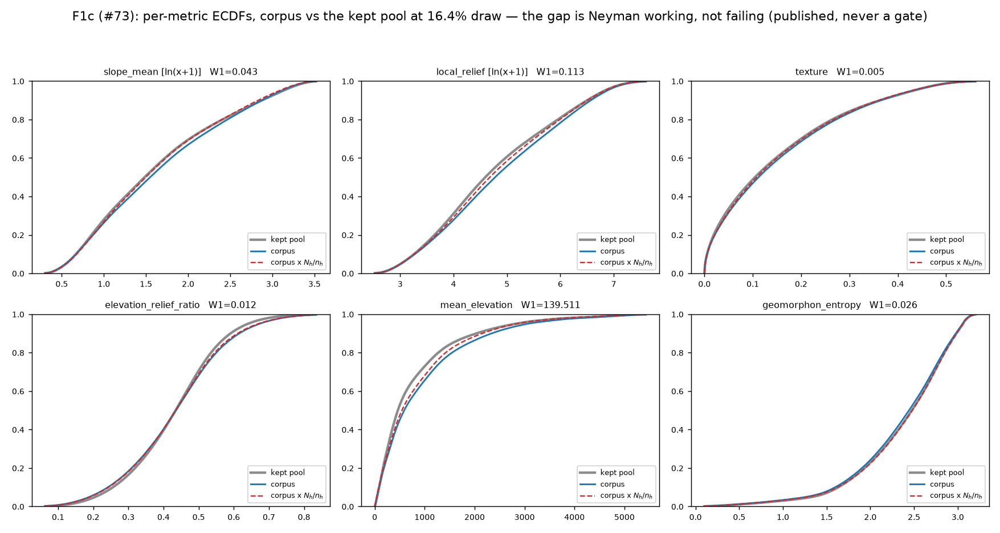
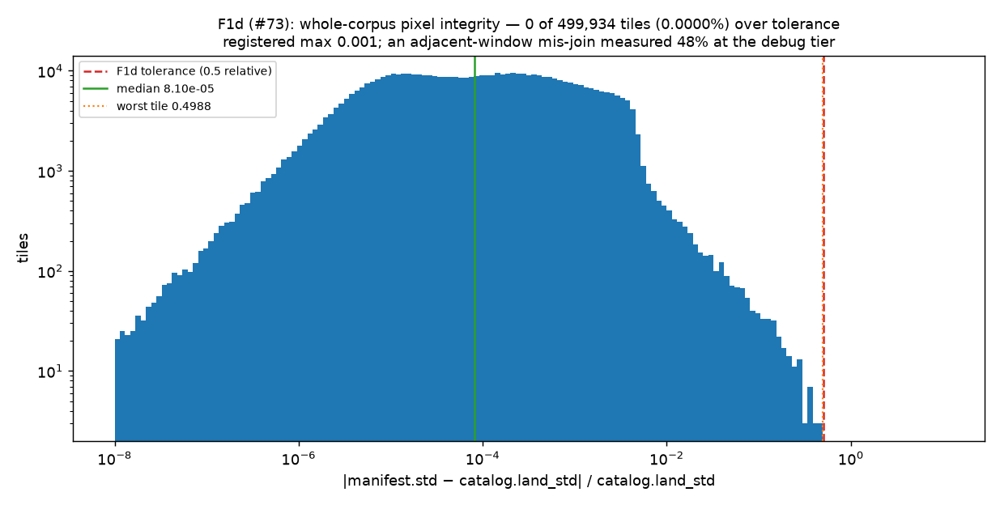
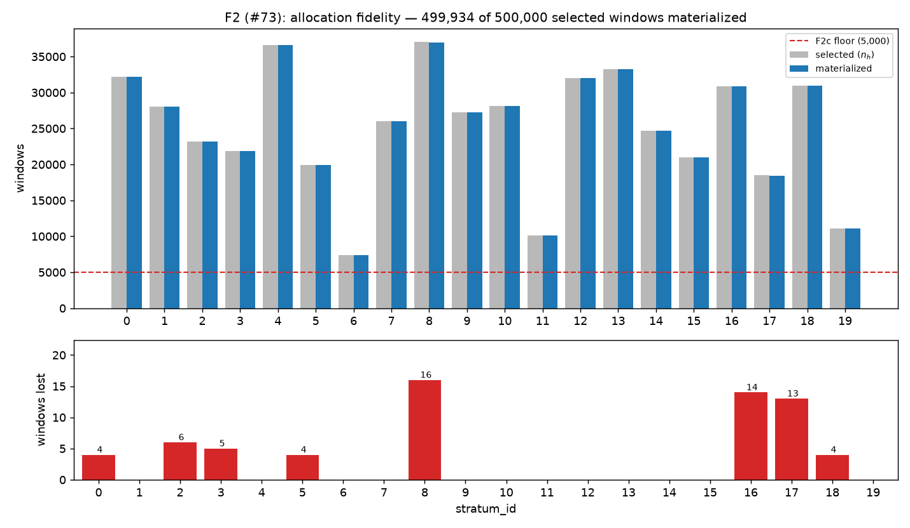
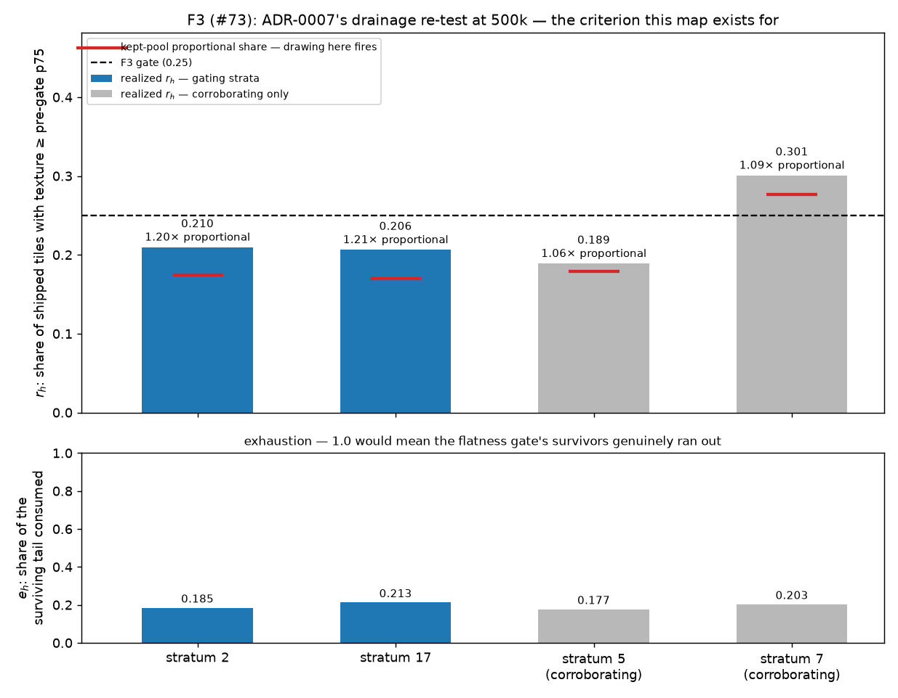
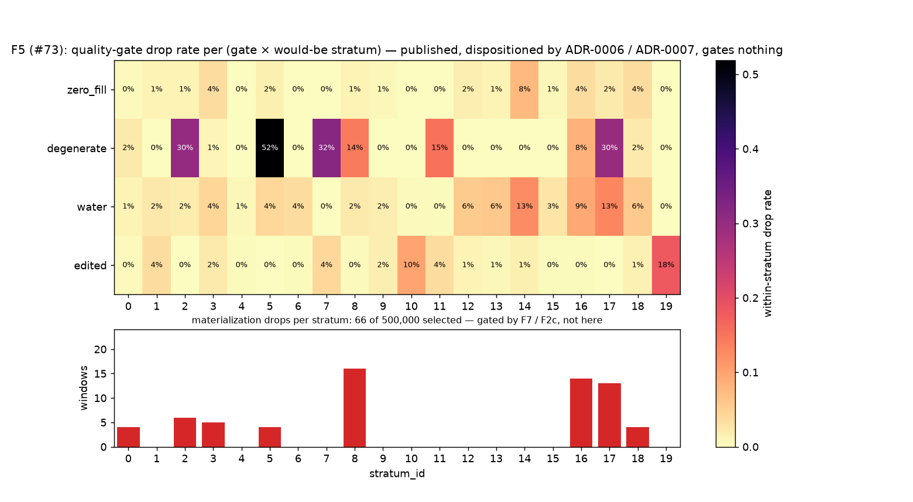
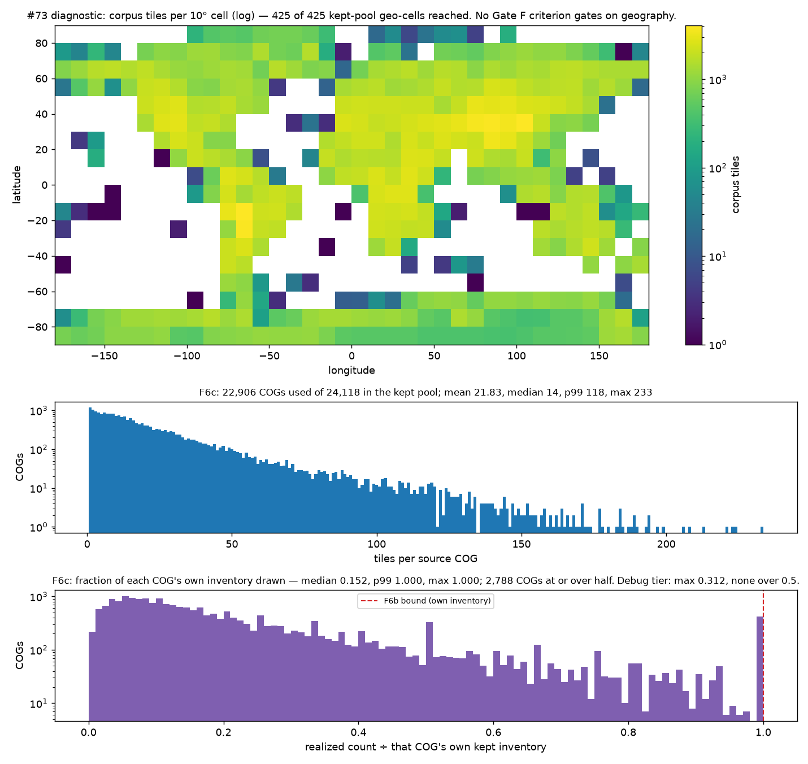

# Gate F — the quantitative validation report (the 500,000-window scale tier)

**Ticket:** [Run the Gate F validation report + gallery (#73)](https://github.com/JStoschek/DEMAE/issues/73) ·
**Map:** [Phase F (#67)](https://github.com/JStoschek/DEMAE/issues/67) ·
**Bar:** [`f-gate-bar.json`](f-gate-bar.json) / [`f-gate-bar.md`](f-gate-bar.md) ·
**Rules:** [`dataset/validate_f.py`](../../src/dataset/validate_f.py) ·
**Numbers:** [`f-validation-report.json`](f-validation-report.json) ·
**Gallery:** [`f-gallery.md`](f-gallery.md)

[#71](https://github.com/JStoschek/DEMAE/issues/71) drew a 500,000-window selection list and
[#72](https://github.com/JStoschek/DEMAE/issues/72) turned it into shards, a manifest and a
ledger. This reads all three back and runs them against the bar
[#69](https://github.com/JStoschek/DEMAE/issues/69) pre-registered **before any of them
existed**.

Produced by
[`notebooks/f_validation_report.py`](../../notebooks/f_validation_report.py). Every number
it gates on comes off the committed bar through
[`dataset.validate_f`](../../src/dataset/validate_f.py) — Gate E's
[`validate.py`](../../src/dataset/validate.py) is **frozen** (ADR-0006 and ADR-0007 rest on
its registered numbers), so this runs against the sibling module that reuses E's pure rule
functions under Gate F's own constants. No sampling anywhere: the whole 4,386,720-row
catalog, the whole 500,000-row selection list, all 499,934 tiles, and — for `F8` — all 47 GB
of shards.

> **This report does not render the verdict.** It reports each criterion against its
> pre-registered threshold, emits the payload for anything that fired, and hands the calls
> the bar does not settle to Gate F ([#74](https://github.com/JStoschek/DEMAE/issues/74))
> as named open questions with their evidence. `verdict` in the JSON is `null`.

Copyright / attribution (mask spec §5, Art. 6(b)): *produced using Copernicus WorldDEM-30
© DLR e.V. 2010-2014 and © Airbus Defence and Space GmbH 2014-2018 provided under
COPERNICUS by the European Union and ESA; all rights reserved.*

## 0. Scoreboard

| criterion | class | gates | result |
|---|---|---|---|
| **F1a** metric fidelity | Defect | yes | **pass** — 0 of 499,934 rows differ |
| **F1b** drop selectivity | Defect | yes | **FIRED** — 4 of 6 metrics above their own null's p99 |
| **F1c** pool ECDF | published | no | W1 0.005–139.5; reweighting cuts it 1.2–3.4× |
| **F1d** pixel integrity | Defect | yes | **pass** — 0 tiles over tolerance; worst single tile 0.4988 |
| **F2a** selection integrity | Defect | yes | **pass** — md5, 500,000 rows, every `n_h`, both provenances |
| **F2b** materialization counts | Defect | yes | **pass** — no stratum over its allocation |
| **F2c** thin stratum | Finding | yes | **pass** — min realized 7,343; neither limb trips |
| **F2d** coastal floor | Finding | yes | **pass** — 1.3394% vs the registered 1.337%, by 11 tiles |
| **F3** drainage representation | **Finding** | yes | **FIRED** — `r₂` = 0.2097, `r₁₇` = 0.2065 against 0.25 |
| **F3** p75 precision sensitivity | published | no | same rule at full precision — does not move the outcome |
| **F4** gallery | published | no | 20 sheets rendered; the labels are #74's |
| **F5** gate × stratum attrition | published | no | the same 5 pairs, **bit-identical** to Gate E |
| **F6a** distinctness | Defect | yes | **pass** — 500,000/500,000 and 499,934/499,934 |
| **F6b** COG inventory bound | Defect | yes | **pass** — no COG over its own kept inventory |
| **F6c** COG spread | published | no | max 233 of a 256-window ceiling; 423 COGs drawn dry |
| **F7** attrition expectation | Defect | yes | **pass** — 66 drops, rate 1.32e-4 against 4e-4 |
| **F7b** registered status set | Defect | yes | **pass** — only `ok`, `degenerate`, `zero_fill` |
| **F7c** ledger statuses | published | no | 62 `degenerate`, 4 `zero_fill` |
| **F8** normalization statistic | Defect | yes | **FIRED** — `global_std` differs in its last 4 ULP |

All **18** criteria the bar registers were executed and emitted; the JSON's
`registry_reconciliation` block diffs the two sets in both directions, because a criterion
silently not run would look exactly like a criterion that passed — the scoreboard would
simply be one row shorter, and nobody counts rows. The **F3 p75 precision sensitivity** is
the one row above that the bar does *not* register: it is this report's own diagnostic
(§5.2), listed under `emitted_but_not_registered` so a reader counting against the bar's
own table knows which is which. Gate E's report carried `E2.5_baseline_sensitivity` the same
way.

**Three gating criteria fire: two Defects (F1b, F8) and one Finding (F3).** Eleven pass.
The corpus reproduces its committed list, its allocation, its metrics and its pixels; what
fires is one design question the map exists to ask (F3) and two criteria whose registered
form met an input at scale that it does not cleanly cover (F1b, F8). All three are set out
below with their evidence, and all three are handed to §12 rather than resolved here.

## 1. What was read

| | |
|---|---|
| corpus | `data/corpus_500k/` — 499,934 tiles, `dataset_version` `bcbd6484…`, built by #72 at `43d26cc` |
| ledger | [`artifacts/phase_f/materialization_ledger.parquet`](../../artifacts/phase_f/materialization_ledger.parquet) — 500,000 rows |
| selection list | [`artifacts/phase_f/selection_scale_500k.csv`](../../artifacts/phase_f/selection_scale_500k.csv) — md5 `90d74c8969…` as loaded |
| gated catalog | `data/catalog_gated/` — 4,386,720 rows, `keep` 3,052,735 |
| allocation | [`f-gate-bar.json`](f-gate-bar.json) `committed_inputs.allocation.n_h`; `N_h` from [`f-allocation-nh-500k.json`](f-allocation-nh-500k.json) |
| contract | `accept_shortfall` — a **committed input** at Gate F, not a branch |
| F8 branch | `tier_specific`, read from `corpus_meta.json:normalization_stat_source` |
| F1b seed | 73, at the bar's registered 10,000 permutations |

The run is **≈13 minutes** and zero-network. Three minutes of that is `F8` reading 47 GB of
shards back; most of the rest is `F1b`'s 10,000-permutation null over 500,000 windows. The
catalog and the shards are not in git; the manifest, the ledger, this report, its figures
and the gallery are.

## 2. Where the ticket was stale, and where the bar met a different input

### Two pointers in #73's scope text, corrected by #69

This ticket was written before the bar was pinned, and #69's resolution comment corrected
it on two points. This report follows the comment:

- **`dataset.validate_f`, not `dataset.validate`.** Gate E's module is frozen; rescaling
  its thin-stratum floor in place would have silently re-pointed *Gate E's* measurements at
  5,000. Every carried-over outcome is relabelled, so nothing in this artifact names
  `E2.2c` in a Gate F report.
- **There is no per-COG spread tripwire to execute.** It was retired, not rescaled: a 1°
  COG holds at most 256 kept windows and the average draw is 16.4% of the pool, so a cap of
  64 sits *inside* the healthy range and would fire on a perfect corpus. Its job is done by
  `F6b_cog_inventory_bound` (gating, §8) and `F6c_cog_spread_published` (the measurement
  [#42](https://github.com/JStoschek/DEMAE/issues/42) asked this tier to carry forward).

The gallery's status, which #73 left to #69: **published, non-gating**. Its former gating
role is `F1d_pixel_integrity` (§3.4).

### Four places the registered phrasing met a different input at scale

Named here rather than silently re-interpreted. `read_bar`'s refusal-on-drifted-prose
catches a threshold that moves; it cannot catch a threshold that was never filled in.

1. **`F2a`'s expected md5 is `null` in the bar.** #69 committed before #71 drew and
   delegated the hash to `selection_md5_owner`. It is resolved from
   [`f-scale-draw.json`](f-scale-draw.json) → `determinism.selection_md5`, and
   cross-checked against `corpus_meta.json` → `build_params.selection_list_md5` — the list
   the *builder* consumed. Both are `90d74c896d1fa04f7079b8491781c21e`. A disagreement
   between them raises rather than being published as a curiosity: F2a compares the
   report's own load against #71 and would pass while the shards came from elsewhere.
2. **`F2a`'s provenance table is stated as a sum, not a table.** Gate E's bar carried
   `{base: 49330, floor:coastline: 670}` literally; Gate F's says only *"both provenance
   tags summing to `coast_floor` = 6700"*. The expectation is therefore **derived** from
   `budget` and `allocation.coast_floor` under #71's committed vocabulary:
   `{base: 493300, floor:coastline: 6700}`. A derived expectation is a weaker thing than a
   registered one and is labelled as such in the JSON.
3. **The attrition contract is a committed input, not a branch.** `FBar` has no
   `live_branch`, because [#50](https://github.com/JStoschek/DEMAE/issues/50) settled it at
   Gate E. The corpus card is *checked against* the committed value rather than consulted
   for it; a disagreement raises.
4. **`F8`'s `tier_specific` branch requires reading every shard.** "Reproduces exactly from
   the shipped 500k tiles" is a claim about pixels, and the recorded statistic came from an
   accumulator the builder carried while writing — so checking it against that
   accumulator's saved value would be checking a number against itself. The recompute uses
   `dataset.normalize.land_moments` and `dataset.materialize.global_stats`, the same code
   the builder ran rather than a second version of it. See §10 for what happened anyway.

## 3. F1 — the metrics, and for the first time the pixels



### 3.1 `F1a` metric fidelity *(Defect, exact — passes)*

For all **499,934** materialized tiles the manifest's frozen-metric values equal the
catalog's for the same `window_id`: **0 mismatches on all six metrics**. Both stores carry
float64, so there is no documented cast to allow for and the comparison is bitwise.

The join is on `window_id` rebuilt from the manifest's `source_cog`/`win_row0`/`win_col0`
columns rather than by string-splitting `tile_id`, so a COG stem containing an underscore
cannot mis-join silently, and a window absent from the catalog is fatal rather than a NaN.

<a id="f1b-drop-selectivity"></a>

### 3.2 `F1b` drop selectivity *(Defect, blind rule — **FIRED**)*

**66 of 500,000** selected windows failed at full res. Per the bar's rule: per-metric
Wasserstein-1 between the dropped and retained sets, against a null that draws random
size-66 subsets from the same 500,000 committed catalog metrics, 10,000 permutations,
seed 73, fire above the 99th percentile.

| metric | observed W1 | null p99 | fires |
|---|---|---|---|
| `slope_mean` | 4.822 | 2.121 | **yes** (2.27×) |
| `local_relief` | 243.67 | 106.62 | **yes** (2.29×) |
| `texture` | 0.06535 | 0.04403 | **yes** (1.48×) |
| `elevation_relief_ratio` | 0.04511 | 0.04775 | no |
| `mean_elevation` | 923.77 | 330.09 | **yes** (2.80×) |
| `geomorphon_entropy` | 0.15610 | 0.18419 | no |

**The rule was blind and stayed blind.** The null depends only on the drop *count*, never on
which windows dropped, so these thresholds materialized at report time from the committed
catalog alone. Nothing about this firing was calibrated against the real drops — which is
the whole point of pinning a rule instead of a number, and the reason this result can be
trusted even though it is inconvenient.

**What the drops are.** The four metrics that fire are the ones a flatness screen would be
expected to move, and the separation is not subtle:

| | dropped (n=66) | retained (n=499,934) |
|---|---:|---:|
| `slope_mean` median | 1.29° | 3.71° |
| `local_relief` median | 14.4 m | 117.7 m |
| `texture` median | 0.0526 | 0.1119 |
| `mean_elevation` median | 5.8 m | 590.6 m |
| catalog `land_std` median | 3.07 m | 24.22 m |

62 of the 66 are `degenerate` — the `land_std < 3 m` re-screen — and a `degenerate` screen
*is* a terrain threshold. So the attrition is terrain-selective, and F1b, whose registered
null model is "attrition is random with respect to terrain", detects it.

**This is the same mechanism `F7`'s derivation describes and treats as benign**, which is
the tension §12 hands to #74. At Gate E's D = 2 the same rule passed with every observed W1
between a third and a half of its null p99; the bar's own `power_disclosure` says D = 20
would be "only marginally" better than that. D came in at 66, and the test found what it
was pointed at.

### 3.3 `F1c` corpus vs the kept pool *(published, never a gate)*

| metric | W1 corpus vs pool | W1 reweighted (`N_h/n_h`) vs pool | cut |
|---|---|---|---|
| `slope_mean` [ln] | 0.0425 | 0.0173 | 2.5× |
| `local_relief` [ln] | 0.1130 | 0.0464 | 2.4× |
| `texture` | 0.0049 | 0.0025 | 2.0× |
| `elevation_relief_ratio` | 0.0116 | 0.0094 | 1.2× |
| `mean_elevation` | 139.51 m | 74.95 m | 1.9× |
| `geomorphon_entropy` | 0.0260 | 0.0077 | 3.4× |

The bar is explicit that this can never gate: the corpus is **deliberately** not
pool-distributed, because Neyman over-samples the rare rugged strata on purpose. The number
to read is the second column — re-weighting each tile by its stratum's inclusion odds cuts
W1 on every metric and walks the dashed curve back onto the grey pool curve in all six
panels. The over-sampling is the intended one.

At 16.4% of the pool the raw distances are slightly *larger* than Gate E's at 1.6% on five
of the six metrics (`mean_elevation` 139.5 m against 134.6 m; only `geomorphon_entropy`
falls, 0.0260 against 0.0297). That is what a deeper draw into the same Neyman shares should
do: the stratum weights are unchanged, so the corpus does not move towards the pool — it
just resolves each stratum's own spread more finely.

### 3.4 `F1d` pixel integrity *(Defect — passes)*



**The first Gate criterion in this project to open a shard.** `F1a` compares the manifest's
frozen metrics to the catalog's, but [`manifest.py`](../../src/dataset/manifest.py) *copies*
that vector from the catalog — so `F1a` verifies the join and not the imagery. The
manifest's `std` column is the one field computed from the **stored int16 array**
([`normalize.prepare_tile`](../../src/dataset/normalize.py)), and the catalog's `land_std`
was computed independently at full res in Phase C.

| | @500k (measured here) | debug tier as-built | adjacent-window mixup | full shuffle |
|---|---|---|---|---|
| median relative disagreement | **8.10e-5** | 8.37e-5 | 0.477 | 0.867 |
| p99 | 0.0063 | — | — | — |
| tiles over 0.5 relative | **0 (0.0000%)** | 0 | 48.1% | 76.2% |

Zero of 499,934 tiles exceed the tolerance, against a registered maximum of 0.1%. The
median sits at the int16 quantization floor, essentially unchanged from the debug tier.

**One number worth carrying forward:** the worst single tile disagrees by **0.4988**, which
clears the 0.5 tolerance by 0.0012. The debug tier's worst was 0.46. The criterion is a
*share* and the share is zero, so nothing about the pass is marginal — but the benign tail
now reaches the tolerance line, and a future tier should expect it to cross.

This criterion does **not** test plausibility. A corruption preserving land-std — a
horizontal flip — passes it and would be obvious by eye, which is part of why `F4`'s gallery
is still rendered (§6).

## 4. F2 — the list and the allocation



### 4.1 `F2a` selection integrity *(Defect, zero tolerance — passes)*

md5 `90d74c896d1fa04f7079b8491781c21e` as loaded, **500,000 rows**, per-stratum counts equal
to every one of the bar's 20 `n_h` entries, provenance `base` 493,300 / `floor:coastline`
6,700. Nothing off.

That this passes is not free. As originally committed, twelve of the bar's twenty `n_h`
entries were off by ±1–2 windows, and **F2a would have fired a Defect on a correct draw**.
#71 published the deltas rather than editing a pre-registered file it had just drawn
against, and #69 corrected the table in a separate dated commit with its own justification
(see [`f-gate-bar.md`](f-gate-bar.md)'s amendment section). The procedure worked; §12 notes
where the same class of mistake shows up again in the same file.

### 4.2 `F2b` materialization counts *(Defect — passes)*

Under `accept_shortfall` the only defect is a stratum with **more** tiles than it was
allocated, which is duplication. There are none. Eight strata are under their allocation —
0, 2, 3, 5, 8, 16, 17, 18 — by a combined 66 windows; how much a stratum lost is `F2c`'s
question, not this one.

### 4.3 `F2c` thin stratum *(Finding — passes, both limbs)*

- **Absolute limb.** Smallest realized count is **7,343** (stratum 6, which lost nothing)
  against the rescaled floor of 5,000. The floor is #42's `max(500, 1%·budget)` evaluated at
  this budget and is structurally inert here, exactly as registered — it is retained to name
  the event where attrition makes an inert clamp retroactively binding, and that event did
  not happen.
- **Relative limb.** Corpus-wide drop rate is 1.32e-4. **Three strata clear the 3× ratio
  half** — 17 at 5.33×, 16 at 3.44×, 8 at 3.27× — and none comes near the second half: the
  largest loss is **0.070%** of an allocation against a 2% limb. This is the conjunction
  doing exactly the work #47 designed it for: a bare drop-rate ratio detonates on a small
  denominator, and thirteen windows out of 18,472 is not a thin stratum. The bar disclosed
  this limb as effectively non-binding at this tier — the 2% half needs 147 drops inside
  the *smallest* stratum against ~20 expected corpus-wide — and it was.

### 4.4 `F2d` coastal floor *(Finding — passes)*

**6,696** of 499,934 tiles carry the `coastline` tag: a realized rate of **1.3394%** against
the registered within-frame rate of **1.337%**. The margin is **11 tiles** — the minimum
count that satisfies the rate is 6,685.

The floor is honoured as the rate it always was, never rounded up to the count 6,700 and
never described as "met". 6,700 windows were selected with `floor:coastline` provenance and
6,696 materialized; the four losses are the four coastal drops in the ledger. The bar's
`exposure_note` predicted this criterion would have real teeth, because coastline windows
are by construction high-zero-fraction and so the population most exposed to the zero-fill
re-screen. Four of the corpus's four `zero_fill` drops being coastal is that exposure,
measured — and the rate still clears.

<a id="f3-drainage-representation"></a>

## 5. F3 — the drainage re-test *(Finding — **FIRED**)*



This is the criterion map #67 exists for: ADR-0007's Phase-F revisit trigger on the strata
2/17 drainage loss, "accept-for-now, re-test at scale". Everything else in this report is
bookkeeping by comparison.

For stratum *h*, `r_h` is the share of shipped stratum-*h* tiles whose `texture` reaches
that stratum's **pre-gate p75** — so the reference is 0.25 by construction, and it is the
drainage share the terrain itself has before the flatness gate touches it. Fire if
`r_h < 0.25`.

| | stratum 2 | stratum 17 | stratum 5 | stratum 7 |
|---|---|---|---|---|
| gates | **yes** | **yes** | no (corroborating) | no (corroborating) |
| pre-gate p75 `texture` | 0.017817 | 0.026826 | 0.003348 | 0.141502 |
| tiles shipped | 23,153 | 18,459 | 19,905 | 26,043 |
| drainage tiles shipped | 4,856 | 3,811 | 3,762 | 7,835 |
| **realized `r_h`** | **0.2097** | **0.2065** | 0.1890 | 0.3008 |
| kept-pool proportional share | 0.1741 | 0.1701 | 0.1791 | 0.2767 |
| `r_h` ÷ proportional share | 1.20× | 1.21× | 1.06× | 1.09× |
| exhaustion `e_h` | 0.1848 | 0.2127 | 0.1770 | 0.2031 |
| **verdict** | **fires** | **fires** | — | — |

Both gating strata fall short. Strata 5 and 7 are computed identically and reported as
corroboration only, never independent triggers — ADR-0007 scoped its trigger to 2/17,
stratum 5 drops genuine low-information smooth plains, and stratum 7's `texture` is
sub-metre sastrugi running the opposite way.

### 5.1 The attribution the bar asked for, published beside the verdict

The bar's first design was a conjunction — fire only if the draw both *exhausts* the
surviving drainage tail and leaves the corpus deficient — and it recorded that this is
**logically unsatisfiable** at 500k, because `n_h` ≈ the tail size makes `r_h` and `e_h` the
same statistic up to a constant. So the gate is single-limb and the attribution is
published instead. Reading it as the bar's `how_to_read_it` clause directs:

- `r_h` lands **20% above** the kept-pool proportional share, not on it. FSCS did over-draw
  the drainage tail relative to proportional sampling — it is coverage-balanced in the
  standardized six-metric space and the tail is a sparse region — but at 1.20×, not the
  ~1.44× (stratum 2) or ~1.47× (stratum 17) that reaching 0.25 required.
- Exhaustion is **0.18–0.21**, nowhere near the ceiling. **Roughly four fifths of the
  surviving drainage tail was left on the table**: 26,271 kept drainage windows in stratum 2
  against 4,856 shipped, 17,914 against 3,811 in stratum 17.

In the bar's own terms that is the *sampler-behaviour* end of the spectrum rather than the
*survivors-ran-out* end. Whether the flatness knob is nonetheless implicated is #74's call,
and §12 states it as an open question rather than resolving it here — the bar publishes the
distinction and assigns the reading to nobody.

### 5.2 The bar's own reference table, reproduced — and one place it disagrees with itself

The registered `pre_gate_tail` / `kept_tail` numbers are derived from the committed catalog
and are reproducible. Reproduced at the bar's **printed** six-decimal p75 — the number
`read_bar` freezes and the criterion thresholds on:

| | registered | measured at the printed p75 | measured at full precision |
|---|---|---|---|
| stratum 2 `pre_gate_tail` | 54,421 | **54,421** ✓ | 54,421 |
| stratum 2 `kept_tail` | 26,271 | **26,271** ✓ | 26,271 |
| stratum 17 `pre_gate_tail` | 42,163 | 42,124 ✗ | **42,163** |
| stratum 17 `kept_tail` | 17,930 | 17,914 ✗ | **17,930** |
| stratum 5 `kept_tail` | 21,250 | **21,250** ✓ | 21,250 |
| stratum 7 `kept_tail` | 38,591 | 38,575 ✗ | **38,591** |

The registered tail counts were computed at **full precision**, while the p75 printed beside
them — and frozen by the code — is rounded to six decimals. For strata 17 and 7 that
rounding moves tiles across the line. This is the same display-rounding trap that produced
the `n_h` amendment, in the same committed file.

**It does not move F3's outcome.** The identical rule re-run at the full-precision p75 is
published as `F3_p75_precision_sensitivity`, and it fires on the same two strata: the gap
between 0.21 and 0.25 is not a 39-tile question. The criterion above ran on the frozen
number, as registered; the sensitivity is published so a reader does not have to wonder,
and §12 hands the reference itself to #74.

## 6. F4 — the gallery *(published, non-gating)*

Rendered: [`f-gallery.md`](f-gallery.md), 20 sheets × 12 tiles from the shipped corpus, plus
20 interior→edge diagnostic sheets and the coastal-floor sheet, seed `20260723`. See that
cover for the full argument; in brief, #69 retired E2.4's pass/fail because its registered
question was about `k`, the same persisted centroids give the same partition, and #53/#54
already answered it 20/20. What survives is [#75](https://github.com/JStoschek/DEMAE/issues/75)'s
need for a gallery of the corpus that actually shipped, the terrain-family labels (#74's to
record), and the only look at scale imagery that would catch a corruption preserving
land-std — which `F1d` cannot see.

The cover ships a 20-row terrain-family label table with every cell blank, and there is no
mark column at all — `coherent` / `mixed` / `incoherent` was E2.4's registered vocabulary and
it belonged to a gate that no longer exists, so recording one would manufacture a judgement
the bar declines to ask for. The labels are #74's for the same reason the verdict is: #73
renders the evidence and does not pre-empt the reading of it, exactly as #53 left its table
for #54.

Both draws order by the house keyed BLAKE2b under the committed seed, so every sheet
reconstructs from `manifest.parquet` plus `gallery.json` after the 47 GB of shards are gone.
The 20 uniform sheets ship lossless for that reason; the non-gating sheets ship as WebP.

## 7. F5 — gate × stratum attrition *(published, dispositioned)*



The bar retires E2.5 as a gate on the grounds that it *cannot* return anything new at a
different budget — it reads the catalog and the gates, neither of which has a budget term.
That is a falsifiable claim, so this report tests it rather than quoting it: the pre-gate
membership, the per-(gate × stratum) fires and both corpus-wide baselines are compared
against [`e2-validation-report.json`](e2-validation-report.json).

**Bit-identical on every field.** The same five pairs would fire: `degenerate` × strata
2 (3.08×), 5 (5.32×), 7 (3.25×), 17 (3.04×), and `edited` × stratum 19 (12.10×). Their
disposition is [ADR-0006](../adr/0006-accept-edm-flm-hollowing-stratum19.md) and
[ADR-0007](../adr/0007-accept-degenerate-flatness-gate-flat-strata.md) in full, which map
#67 places out of scope; re-gating them would re-raise a settled FAIL.

The materialization column is the only part a bigger draw moves, and it is excluded from
the identity check for that reason: 66 drops spread over eight strata (8: 16, 16: 14,
17: 13, 2: 6, 3: 5, 0: 4, 5: 4, 18: 4) where the debug tier had 2, both in stratum 8.

One inherited wart, harmless here: `dataset.validate.GATE_KNOBS` still maps only `water` and
`edited`, so the four `degenerate` pairs report `knob: null` even though ADR-0007 added that
row to the plan's §215–228 table. F5 gates nothing at Gate F, so no payload depends on it —
but `F3`, which does gate, names the knob directly and correctly.

## 8. F6 — distinctness, the inventory bound, and the spread



### 8.1 `F6a` distinctness *(Defect, zero tolerance — passes)*

**500,000 / 500,000** distinct `window_id` in the selection list; **499,934 / 499,934**
distinct `tile_id` in the manifest. This closes a hole both count criteria pass through — a
duplicate *inside* the selection list leaves F2a's md5, row count, per-stratum counts and
provenance all matching, and leaves F2b's `realized ≤ selected` true.

### 8.2 `F6b` COG inventory bound *(Defect, zero tolerance — passes)*

No COG yields more windows than its own kept-pool inventory holds. **22,906** COGs appear in
the manifest, and the deepest draw is **233** windows from a COG whose ceiling is 256. The
selection list drew from 22,909, so three COGs contribute no tile at all — a COG can only
leave the manifest by having every window it was drawn for dropped.

This is the mechanical failure the retired cap was actually watching for — a looping read, a
collapsed stratum — stated in the one form that survives a budget change.

### 8.3 `F6c` COG spread *(published)*

| | @50k (Gate E) | @500k |
|---|---|---|
| COGs used | 15,834 | **22,906** of 24,118 in the pool |
| mean windows/COG | 3.16 | **21.83** |
| median | 2 | **14** |
| p99 | 16 | **118** |
| max | 44 | **233** |
| median fraction of own inventory | — | **0.152** |
| max fraction | 0.312 (inventory ≥ 32) | **1.000** |
| COGs at or over half their inventory | 0 | **2,788** |
| COGs drawn dry | 0 | **423** |

The count column alone cannot say whether this is healthy, which is why #69 replaced the cap
with the fraction. Among COGs holding at least 32 kept windows, 1,204 are drawn at half
their inventory or more and the median is 0.132 — against a debug tier where nothing reached
0.5.

There is no per-COG row in the §215–228 knob table, so there is nothing to gate against, and
the bar hands the consequence to #75's honesty notes explicitly: at a 16.4% draw rate,
neighbouring windows from one COG are spatially correlated, which dilutes effective sample
size, and the `dedup` knob does not cover it (its default is grid-guaranteed zero overlap,
preserved at any budget). That is a disclosed property of the scale tier, measured here.

## 9. F7 — attrition

### 9.1 `F7` the rate *(Defect — passes)*

**66 of 500,000** dropped: a rate of **1.32e-4** against the registered maximum of **4e-4**.
The criterion is keyed on the rate so it reads the same at any budget, and the rate clears
with a factor of three to spare.

**The pre-registered expectation does not clear.** The bar wrote down ~20 drops with a
Poisson spread of ±2σ ≈ 11–29, deliberately, "so the report has a number to be surprised
against, not just a threshold to clear". 66 is 10σ above it. And the composition differs
too: the derivation predicted `degenerate` boundary flips and nothing else, but four of the
drops are `zero_fill`.

The derivation's mechanism is measurably wider than assumed. It reasoned from a flip band
≈0.001 m wide around the 3.0 m threshold; the dropped windows' catalog `land_std` is spread
far past that:

| catalog `land_std` of a dropped window | count |
|---|---|
| within 0.001 m of the 3.0 m threshold | **0** |
| within 0.005 m | 4 |
| within 0.01 m | 7 |
| within 0.05 m | 24 |
| within 0.1 m | 42 |
| within 1.0 m | 63 |
| below the threshold | 0 |

Median 3.071 m, max 6.747 m. The obvious place to look is `F1d`'s own measurement: the two
`land_std` computations agree to 8.1e-5 at the median but to only 6.3e-3 at the p99, and a
0.6% disagreement at `land_std` = 3.0 is 0.019 m — twenty times the assumed band. The
criterion passes on the number it gates; the derivation behind the expectation it was told
to be surprised against does not survive contact with the data. §12 hands that to #74.

### 9.2 `F7b` registered status set *(Defect, zero tolerance — passes)*

Every ledger status is one the bar registered: `ok` 499,934, `degenerate` 62, `zero_fill` 4.
No `no_land`, nothing unregistered. This is what keeps an I/O failure mode from being
absorbed into F7's count, and nothing was.

### 9.3 `F7c` ledger statuses *(published)*

62 `degenerate` and 4 `zero_fill`, across eight strata, four of them coastal. No `detail`
string is recorded on any dropped row.

<a id="f8-normalization-statistic"></a>

## 10. F8 — the normalization statistic *(Defect — **FIRED**)*

The live branch is **`tier_specific`**, read from `corpus_meta.json` through
`FBar.live_normalization_branch`, which refuses a branch the bar never pre-committed. Its
registered test: `global_mean` and `global_std` **reproduce exactly** from the shipped 500k
tiles. Tolerance: exact.

| | recorded | recomputed from 47 GB of shards |
|---|---|---|
| `global_mean` | 955.6728901295354 | **955.6728901295354** — bit-identical |
| `global_std` | 1012.1607171908565 | 1012.160717190857 |

`global_std` differs by **4 ULP** — an absolute difference of 4.5e-13 m and a relative one of
**4.5e-16**, about two machine epsilons. The rule compares with `!=` against a registered
tolerance of "exact", so it fires as a Defect.

**The pixels are the same pixels.** The builder's own accumulators, checked against the
recompute's raw additive sums, are the evidence that separates "different corpus" from
"different summation order":

| | builder (`build_state.json`) | recompute |
|---|---|---|
| `land_count` | 25,026,746,623 | **identical** |
| `land_sum` | 23,917,383,275,742.0 | **identical** |
| `land_sqsum` | 4.849632882968011e16 | differs by **3 ULP** |

Same pixel count, same sum, different sum of squares. The builder accumulated moments one
tile at a time as it wrote; this report accumulates them over 512-tile blocks read back from
the shards, so the additions associate differently.
[`materialize.global_stats`](../../src/dataset/materialize.py)'s own docstring puts the
variance at "four digits of cancellation out of sixteen" and explains why plain sums were
chosen over a pooled Welford merge — the number this criterion fired on is the one that
docstring is about.

**This report does not loosen the tolerance.** Choosing a float comparison after seeing how
far apart the two numbers are is precisely the peeking the pre-registration exists to
prevent. F8 fired; the numbers are above; the call is #74's.

## 11. Geographic coverage — a diagnostic, not a criterion

Gate F registers **no** geographic criterion. #69 retired E2.3's per-COG tripwire and did
not replace it with a coverage rule, because any geographic pass condition smuggles
geo-uniformity back in against Neyman. #73's scope asks for the coverage map and the
per-geo-cell counts as diagnostics, so they are computed and published under no criterion
number.

| | @50k (Gate E) | @500k |
|---|---|---|
| catalog cells occupied (10°) | 472 | 472 |
| kept-pool cells occupied | 425 | 425 |
| **corpus cells reached** | 400 | **425 — all of them** |
| kept-pool cells unreached | 25 | **0** |
| max tiles in one cell | — | 4,098 |
| median tiles per occupied cell | — | 1,117 |

The debug tier could not reach 25 of the kept pool's cells; the scale tier reaches every
one. That is the single cleanest thing a tenfold budget bought, and it is exactly the kind
of statement #75's honesty notes should be able to make with a number rather than an
adjective.

## 12. Open questions handed to #74

Executing a bar blind means being explicit about where executing it leaves a question
standing. Each of these is emitted by the report *conditional on a measurement*, never on a
reading, and each is in the JSON under `open_questions` with its full evidence. None of them
changes a fired flag above, and this report resolves none of them.

### Q1 — `F1b` fires as a Defect on the mechanism `F7`'s derivation calls benign

F1b's registered null model is "attrition is random with respect to terrain". F7's
derivation says the drops are `land_std` values flipping across the 3.0 m `degenerate`
threshold — which is a terrain threshold, so drops concentrated at the flat end are the
*predicted* outcome, not a departure from it. **The two criteria cannot both be read
literally on this corpus.** At Gate E's D = 2 the question could not arise; the bar's
`power_disclosure` anticipated D ≈ 20 and warned the test would be weak, and instead D = 66
gave it enough power to detect the mechanism the bar itself described.

Evidence: §3.2's table, §9.1's band table, and the full `observed_w1` / `null_p99` vectors in
the JSON. Any re-reading of F1b's null model is #74's, along with the Defect-first roll-up.

### Q2 — `F8`'s "exact" against a streamed float64 accumulator

Whether a recompute that provably reads the *same pixels* in a different block order can
satisfy "exact" at all is a question about the criterion, not about the corpus. This report
may not answer it: any tolerance it chose would be chosen after seeing the number. Evidence
is §10 in full — 4 ULP, identical `land_count` and `land_sum`, and
`materialize.global_stats`' own account of the cancellation involved.

### Q3 — `F3`'s attribution, for both gating strata

The bar publishes how to read `r_h` against the kept-pool share and the exhaustion ceiling
and then assigns the reading to nobody. Measured: `r_h` = 0.2097 / 0.2065, proportional
share 0.1741 / 0.1701, exhaustion 0.1848 / 0.2127. That is 1.2× proportional with four
fifths of the surviving tail untouched — the sampler-behaviour end, not the
survivors-ran-out end. If F3's firing is to reopen ADR-0007's flatness knob, this is the
number that has to carry it, and declaring the fresh map is #74's under map #67's
Destination clause.

### Q4 — the registered pre-gate p75 disagrees with the registered tail counts

The bar's `pre_gate_tail` / `kept_tail` are full-precision; the p75 printed beside them, and
frozen by `read_bar`, is rounded to six decimals. For strata 17 and 7 that moves tiles
(§5.2). The rule ran on the frozen number as registered, and the published sensitivity says
the choice did not change F3's outcome — but the committed file disagrees with itself, and
#69's own `post_commit_corrections` is the procedure for that.

### Q5 — `F7` passes the threshold it gates and misses the expectation it was given

66 drops against a pre-registered ~20 (±2σ 11–29), with four `zero_fill` the derivation did
not anticipate and a flip band two orders of magnitude wider than the 0.001 m it assumed
(§9.1). The bar registers no rule for "clears the threshold, misses the expectation", which
is the honest consequence of writing down a number to be surprised against.

## 13. Reproducing this

```bash
uv run python notebooks/f_stratum_gallery.py     # ~4 min, writes docs/research/f-gallery/
uv run python notebooks/f_validation_report.py   # ~13 min, writes this report's JSON + figures
```

Both are zero-network and take every path as an argument. The report refuses to run against
a bar whose prose has drifted from `dataset.validate_f`'s constants, against a corpus card
whose attrition contract disagrees with the committed input, against a normalization branch
the bar never pre-committed, and against a corpus built from a selection list other than the
one #71 committed. `--permutations` and `--shard-limit` exist for smoke runs and stamp
`smoke_run: true` into the artifact so a smoke output cannot be mistaken for this one.

The rules themselves are unit-tested against hand-built frames in
[`tests/test_validate_f.py`](../../tests/test_validate_f.py) — no corpus, no network —
including that Gate E's bar still loads against Gate E's module and that the two disagree
about the thin-stratum floor.
