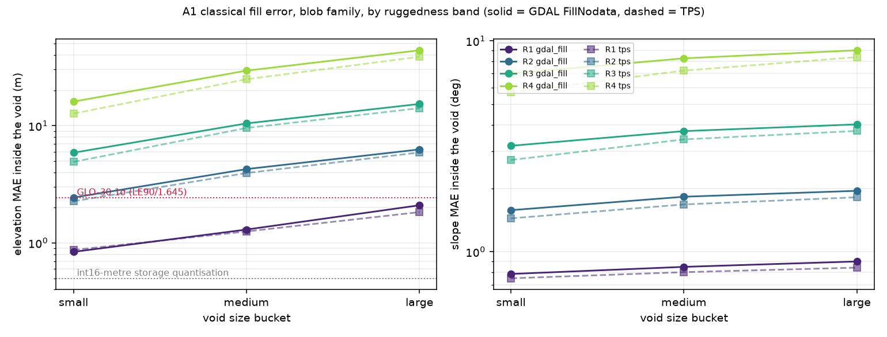

# P119 — how much headroom does the A1 classical fill actually leave?

Ticket [#119](https://github.com/JStoschek/DEMAE/issues/119) · map [#117](https://github.com/JStoschek/DEMAE/issues/117) · plan [`task1-void-fill-plan.md`](task1-void-fill-plan.md) §2.2, §2.4.4, §8

> **What this document is.** A measurement, not a proposal. Every learned arm in the Task 1
> plan predicts a **residual over the A1 fill** (§2.4.4), which makes A1's error the entire
> dynamic range the benchmark can score. Nobody had measured it. This cuts synthetic voids into
> clean test-split tiles, fills them with each A1 candidate §2.2 names, and scores metres and
> slope *inside the void*. All numbers below are measured on the real corpus — 1,600 tiles out
> of `data/corpus_500k`, 48,000 scored instances, CPU-only, 9.7 min wall clock. Artifacts:
> [`p119-fill-headroom.json`](p119-fill-headroom.json), `prototypes/out/p119_instances.parquet`
> (48,000 rows, one per instance), [`p119-fill-headroom.png`](p119-fill-headroom.png).

## 1. Bottom line

**There is a great deal of headroom, and the plan is stratifying on the wrong axis to see it.**

1. **Classical fill is nowhere near the sensor floor in aggregate.** Pooled over the corpus, the
   best variant leaves **MAE 5.2 m on small voids** (16–48 px equivalent diameter), 9.9 m on
   medium, 15.1 m on large. GLO-30's own vertical accuracy is σ ≈ 2.43 m (LE90 4 m / 1.645).
   Only **42%** of small-void instances land under that σ. Small voids are *not* nearly solved.
2. **Ruggedness dominates void size, by a lot.** Split by terrain (§3): on the flattest quartile
   (R1, median slope 1.0°, relief 40 m) even a *large* void fills to **1.8 m MAE**, and a small
   one to **0.87 m** — at that point you are within a factor of two of the int16-metre storage
   quantisation, and 96% of instances beat σ. On the roughest quartile (R4, 12.9°, 583 m relief)
   a *small* void already costs **12.7 m** and a large one **38.6 m**, with 0% beating σ. The
   spread across ruggedness bands is ~40×; the spread across size buckets is ~3×.
3. **The plan's §8 risk is real but mis-specified.** It reads: *"if bilinear fill is too good on
   small voids, learned residuals look like noise; the small-void bucket exists to show this
   honestly (C2 only requires parity there)."* The parity zone is not the small-void bucket — at
   5.2 m MAE that bucket has ample headroom. The parity zone is **flat terrain**, specifically
   R1, and it applies across *every* size bucket. As currently written the C2 parity carve-out
   protects the wrong cell and leaves the actually-saturated cell unmarked.
4. **Which classical fill you pick barely matters.** TPS is the best variant everywhere, but it
   beats GDAL `FillNodata` on only **52–59%** of instances, with a **median** advantage of
   0.16–0.24 m. Its mean advantage (1.3–2.2 m) comes almost entirely from avoiding tail
   blowups. The plan names bilinear `fillnodata` as A1; that choice costs ~0.2 m on a typical
   tile and is not worth revisiting. **The headroom is set by terrain, not by the interpolator.**
5. **Slope error tells the same story and is the more discriminating metric.** Inside the void,
   R1 fills are off by 0.75–0.9° regardless of size; R4 fills are off by 5.7–9.0°. If the
   benchmark wants a metric where learned arms can visibly separate, slope-inside-void does more
   work than elevation MAE.

## 2. What was measured, and how

Voids are **synthetic**, cut into void-free test-split tiles so ground truth exists inside the
void. Two families (`blob`, `rect`) × three size buckets (small 16–48 px, medium 64–96,
large 128–160 equivalent diameter) × five fill variants × 1,600 tiles = 48,000 instances.

Determinism: no RNG state is carried between instances. Every mask is seeded from
`blake2b(tile_id, family, bucket)`, so a tile draws the same void on any machine and **every
variant sees the identical mask** — which is what makes the paired comparison in §4 legal.

Tiles are drawn 400 per ruggedness band, where bands are quartiles of the eligible pool
(n = 13,538) by `slope_mean`. Band medians:

| band | median `slope_mean` | median local relief |
|------|--------------------|---------------------|
| R1 | 1.02° | 40.5 m |
| R2 | 2.67° | 88.8 m |
| R3 | 5.69° | 198.3 m |
| R4 | 12.95° | 583.2 m |

Scoring is inside the void only. Pooled MAE/RMSE are exact (accumulated from per-instance sums,
not averaged averages); per-instance medians and p90s are reported alongside because the pooled
numbers are dominated by the rugged tail.

Reference lines: **σ = 2.43 m** (GLO-30 LE90 4 m / 1.645) and **0.5 m** (int16-metre storage
quantisation — the floor below which this corpus cannot resolve anything).

## 3. The headline table — TPS, blob family, by band

MAE and RMSE in metres, slope MAE in degrees, `<σ` = fraction of instances with RMSE under 2.43 m.

| bucket | band | MAE | RMSE | median RMSE | slope MAE | `<σ` |
|--------|------|-----|------|-------------|-----------|------|
| small | R1 | **0.87** | 1.37 | 0.88 | 0.75 | **0.963** |
| small | R2 | 2.27 | 3.88 | 2.30 | 1.44 | 0.527 |
| small | R3 | 4.91 | 7.80 | 5.09 | 2.72 | 0.172 |
| small | R4 | **12.66** | 20.40 | 13.06 | 5.70 | 0.035 |
| medium | R1 | 1.25 | 1.98 | 1.26 | 0.80 | 0.840 |
| medium | R2 | 3.94 | 6.37 | 4.76 | 1.68 | 0.182 |
| medium | R3 | 9.54 | 15.22 | 11.07 | 3.41 | 0.018 |
| medium | R4 | 24.84 | 39.19 | 28.09 | 7.22 | 0.000 |
| large | R1 | **1.83** | 2.95 | 1.95 | 0.84 | 0.655 |
| large | R2 | 5.91 | 9.38 | 7.20 | 1.81 | 0.050 |
| large | R3 | 14.09 | 22.17 | 17.52 | 3.74 | 0.003 |
| large | R4 | **38.63** | 60.38 | 44.30 | 8.36 | 0.000 |

Read the four bolded cells: the range within a single size bucket, across terrain, is 0.87 → 12.66
(small) and 1.83 → 38.63 (large). The `rect` family tracks `blob` to within ~5% throughout and is
not reproduced here; it is in the JSON.



The left panel is the point: the band curves are separated by more than an order of magnitude,
while each curve's slope across buckets is gentle. R1 sits at or below the σ line everywhere.

## 4. Variant comparison (paired, same masks)

Pooled MAE over all bands, blob family:

| bucket | flat | GDAL `FillNodata` | `FillNodata` si=3 | linear | TPS |
|--------|------|-------------------|-------------------|--------|-----|
| small | 17.01 | 6.26 | 6.11 | 6.45 | **5.15** |
| medium | 27.32 | 11.39 | 11.26 | 12.02 | **9.93** |
| large | 36.58 | 16.84 | 16.72 | 17.87 | **15.08** |

TPS wins on the mean in every cell, but the paired per-instance view deflates it: against GDAL
`FillNodata` the win rate is 0.585 / 0.550 / 0.547 (small/medium/large) and the **median** delta
is 0.19 / 0.17 / 0.24 m. The 95% CI on the *mean* delta (small: [1.13, 1.56] m) excludes zero, so
the advantage is real — it is just concentrated in the tail, where TPS avoids the blowups that a
propagation-based fill produces on rugged terrain.

`flat` (fill with the void-border mean) is included as a floor, not a candidate. That it costs
only ~3× the best variant on large rugged voids is itself a comment on how little the
interpolators recover there.

## 5. What this implies for the plan

Three amendments, applied in this branch:

1. **§8, "A1 pre-fill quality ceiling"** — rewritten to name ruggedness rather than void size as
   the saturating axis, with R1's and R4's numbers.
2. **§0, C2** — the parity carve-out is retargeted from "small voids where splines are strong" to
   flat terrain. C2 now claims a win on rugged terrain *at every void size*.
3. **§5, "Stratification"** — the plan already required per-ruggedness reporting, so nothing new
   is added; the bullet is marked load-bearing, with the 40× vs 3× contrast as justification and
   a tie-break rule (drop a size bucket before a ruggedness band).

Not changed, deliberately: the residual-over-A1 formulation (§2.4.4) survives this measurement
intact — indeed it looks better than before, since a residual head has 5–39 m of signal to learn
in the cells that matter. The choice of bilinear `fillnodata` as A1 also stands (§4).

## 6. Reproducing

```
PYTHONPATH=. uv run --group dev --with pandas python prototypes/p119_fill_headroom_proto.py selftest
PYTHONPATH=. uv run --group dev --with pandas python prototypes/p119_fill_headroom_proto.py run
PYTHONPATH=. uv run --group dev --with pandas python prototypes/p119_fill_headroom_proto.py figure
```

`selftest` gates five seams before any measurement is trusted: mask geometry (bucket diameters,
interiority, 40% area cap, single connected component), mask determinism, fill exactness on a
synthetic plane plus the no-write-outside-the-void invariant, metric identity (zero error on a
perfect fill, a constant offset scoring as pure bias with no slope error), and slope against a
hand-computed ramp.

The harness lives at `prototypes/p119_fill_headroom_proto.py` (throwaway measurement code, not
pipeline code — `prototypes/` is gitignored). `run` checkpoints per tile to
`prototypes/out/p119_instances.ckpt.jsonl` and resumes from it, so an interrupted run does not
start over. Note that `pandas` is not a declared dependency of this repo; the `--with pandas`
above is what supplies it.
