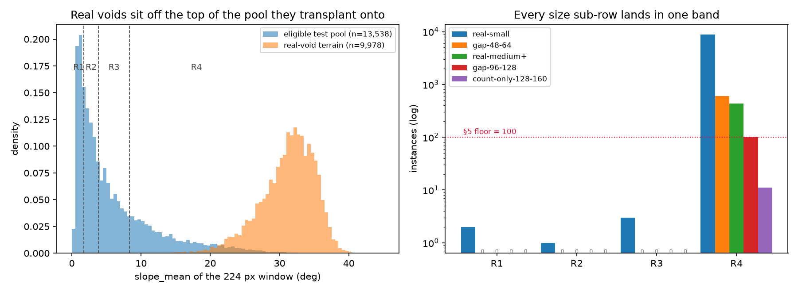

# P135 — the real voids' realised ruggedness histogram, measured

Ticket [#135](https://github.com/JStoschek/DEMAE/issues/135) · map [#117](https://github.com/JStoschek/DEMAE/issues/117) · plan [`task1-void-fill-plan.md`](task1-void-fill-plan.md) §3.3, §5 · granules from [#127](https://github.com/JStoschek/DEMAE/issues/127) · scoping [`p125-srtm-void-geometry.md`](p125-srtm-void-geometry.md) · shape [#126](https://github.com/JStoschek/DEMAE/issues/126)

> **What this document is.** A measurement, not a study. Every number below comes from
> running code over the 24 SRTMGL1N granules #127 put on disk and the 24 matching
> Copernicus GLO-30 cells read off the public bucket. Harness:
> `prototypes/p135_void_ruggedness_proto.py` (gitignored, as p119's and p123's were).
> Every number quoted below is in the committed
> [`p135-void-ruggedness.json`](p135-void-ruggedness.json); the per-component dump behind
> it is 6.6 MB and stays under gitignored `data/`, regenerated by `run` in four minutes:
>
> ```
> uv run --group dev python prototypes/p135_void_ruggedness_proto.py run
> uv run --group dev python prototypes/p135_void_ruggedness_proto.py figure
> ```
>
> Nothing here is projected from a smaller
> sample; where a projection is quoted it is somebody else's, and it is quoted to be
> compared against what was measured.

## 1. Bottom line

**§3.3's prediction is right in direction and wrong in degree, and the degree is what
matters: the real-void family is not concentrated in R3/R4, it is 99.94% R4.** Of 9,978
scored components across 24 granules, **R4 holds 9,972. R3 holds three. R1 and R2 hold
three between them.** Every one of the 24 cells is at least 96.8% R4, both regions, at
every void size.

Four consequences, in order of how much they change the plan:

1. **"Stratified by ruggedness" is a one-column table for this family**, and the wording
   has to say so. §5's population floor was written for exactly this and fires as
   designed — but it fires on three of the four bands at once, so what it produces is not
   a table with a thin band, it is a table with a single band and a footnote reading
   `R1 2, R2 1, R3 3`.
2. **#121's pre-registered rule for real-medium+ is satisfied and simultaneously made
   vacuous.** It said: unstratified unless the realised histogram clears 100 per band.
   Measured, real-medium+ is **438 in R4 and 0 everywhere else** — so it clears the
   threshold in the only band it occupies, and the stratified table and the pooled number
   are the *same number*. The rule was right to pre-register; the outcome it did not
   anticipate is that stratification can be satisfied and empty at once.
3. **The stratum match is a band match, and the band is far too wide at the top.** The
   voids come from terrain with a median `slope_mean` of **31.72°**. The eligible test
   pool's R4 band runs **8.35° to 33.08°** with a median of **12.95°**, and **34.3% of the
   voids are steeper than the ruggedest tile in the entire pool**. §3.3's claim that "the
   stratum-matched transplant preserves that difficulty rather than averaging it away" is
   measurably false at the top of the range: the transplant preserves the void's *shape*
   and its *band*, and drops its native ruggedness by roughly half.
4. **The yield is 2.3× to 4.6× the projection, and the host tiles do not scale with it.**
   #121 projected ~3,800 real-small and ~96 real-medium+ from p125's two-cell sample;
   measured, they are **8,824 and 438**. Every one of them wants an R4 host tile, and
   §3.1's 5,000-tile test draw holds ~1,250 — so real-small alone is **7.1 instances per
   host tile** (2.6× if the family is allowed the whole 3,385-tile R4 pool). That is not
   fatal — §5's bootstrap already resamples *tiles*, which is the correct cluster — but it
   is a property of the family that has to be stated rather than discovered later.

One thing the ticket asked about and did not find: **there is no size story here.** The
band collapse is identical for real-small, real-medium+, and the count-only row. Nothing
about this result depends on which size sub-row is read.



## 2. What was measured, and how

The path §3.3 specifies, in four steps:

1. **Predicate and components.** `num > 10 AND num < 201` over each 3601² `uint8`
   granule, 8-connected labelling, equivalent diameter `d = 2·√(area/π)`, keeping
   `16 ≤ d ≤ 160`.
2. **§3.2's placement tests.** Bounding box inside a 208×208 interior box, area at most
   40% of a 224² tile.
3. **Stratum from GLO-30 at the void's own coordinates**, not from the SRTM pixels around
   the hole. A 224 px window centred on the component, scored with
   `dataset.metrics.slope_mean` at `dataset.geometry.pixel_spacing_m` — the same call
   `dataset.catalog` makes for every window in the corpus.
4. **Bands are the quartiles of `slope_mean` over the eligible test pool**, cut on the
   pool itself (§5): test split, all-land, untagged by Phase C's water flag.

### 2.1 The bands, reproduced

n = **13,538**, matching p119 exactly.

| band | slope_mean range | n | median |
|---|---|---|---|
| R1 | 0.25 – 1.74° | 3,385 | 1.07° |
| R2 | 1.74 – 3.83° | 3,384 | 2.64° |
| R3 | 3.83 – 8.35° | 3,384 | 5.58° |
| R4 | 8.35 – 33.08° | 3,385 | 12.95° |

The bands are quartiles, so they are **equal by construction** — which answers one third
of the ticket's question before any void is read. "Is the test split thin in R4?" cannot
be true: R4 is a quarter of the pool by definition. The supply problem is real but it is
a different one (§5).

### 2.2 The scoring path is the corpus's, checked rather than asserted

`N28E086` has 256 committed catalog rows. Recomputing `slope_mean` for five of them
through this harness's read → spacing → metric path reproduces the committed catalog to
**0.0 absolute difference** on all five, with the window centre latitudes matching to
1e-12. The lattice claim P125 §10.1 rests on is asserted per cell rather than trusted:
each COG is checked for 3600², a pixel size of exactly 1/3600°, and an origin at
`(lon − 0.5/3600, lat + 1 + 0.5/3600)` — the affine that puts GLO-30 pixel centres on
whole arc-second multiples, i.e. on SRTM's sample centres. All 24 passed.

### 2.3 Attrition

| stage | components |
|---|---|
| `d ≥ 16 px` | 10,291 |
| excluded, `d > 160 px` (the giants §3.3 publishes as a tail) | 182 |
| failed §3.2's interiority or 40%-area test | 131 (1.3%) |
| **scored** | **9,978** |

P125 §10.3 measured this attrition on two cells and called it negligible; over 24
granules it is 1.3%, which stands.

## 3. The histogram

Instances by size sub-row × ruggedness band, plan predicate:

| sub-row | R1 | R2 | R3 | R4 | total |
|---|---|---|---|---|---|
| real-small (16–48 px) | 2 | 1 | 3 | **8,818** | 8,824 |
| *gap, 48–64 px* | 0 | 0 | 0 | *604* | *604* |
| real-medium+ (64–96 px) | 0 | 0 | 0 | **438** | 438 |
| *gap, 96–128 px* | 0 | 0 | 0 | *101* | *101* |
| count-only (128–160 px) | 0 | 0 | 0 | 11 | 11 |
| **total** | **2** | **1** | **3** | **9,972** | **9,978** |

Against §5's floor of 100: **one cell in the whole table clears it per sub-row, and it is
always R4.**

### 3.1 The two gap rows are a real hole in §3.3

§3.3 names three sub-rows — 16–48, 64–96, 128–160 — which do **not** tile the 16–160 px
range it says it keeps. The measured draw puts **705 components (7.1%)** in the two
holes. They are excluded here, and §3.3 is amended to say so explicitly rather than leave
7% of the family in a gap between definitions. The exclusion is right on the plan's own
logic: the sub-row boundaries exist to keep real-small size-comparable to the synthetic
*small* bucket (16–48) and real-medium+ to synthetic *medium* (64–96), and widening them
to cover the gaps would destroy the comparability the split exists for.

### 3.2 Per-cell, and per region

| region | cells | scored | R1 | R2 | R3 | R4 |
|---|---|---|---|---|---|---|
| Himalaya / Karakoram | 17 | 8,451 | 1 | 1 | 3 | 8,446 |
| Andes | 7 | 1,527 | 1 | 0 | 0 | 1,526 |

The Andes were kept for geographic diversity rather than volume (§3.3). They deliver the
diversity that was asked for — a different massif, look direction and climate — and
**none at all on the ruggedness axis**: 99.93% R4, median terrain 30.1–32.0° per cell,
indistinguishable from the Himalaya. Per-cell R4 share ranges from **96.8%**
(`S32W070`, 31 components) to **100.0%** (17 of 24 cells).

### 3.3 The measurement does not depend on the one free choice in it

§3.3 says the stratum comes from GLO-30 "through the same code path that assigns strata
to every other tile in the corpus", and does not say *which window*. Centring a 224 px
window on the void is the reading used above — it is the ground the void actually came
from — but it can be accused of framing the steepest feature in its neighbourhood. Two
alternatives, same components:

| window | R1 | R2 | R3 | R4 | median slope | agrees with primary |
|---|---|---|---|---|---|---|
| 224 px centred (primary) | 2 | 1 | 3 | 9,972 | 31.72° | — |
| the corpus's own 224 px grid window | 1 | 1 | 7 | 9,969 | 31.66° | 99.94% |
| 448 px centred | 1 | 1 | 1 | 9,975 | 31.48° | 99.96% |

The choice moves **six components out of 9,978**. It would have to move `slope_mean` by
a factor of ~3.8 to move the answer.

The predicate's one open flag moves it even less. §3.3 flags values 11 and 25 as arguable
(NGA-interpolated SRTMv1 filigree, and GDEM fill that was itself SRTM-derived). Excluding
them — the strict "never observed by radar" mask — gives **9,979** scored components at
`R1 2, R2 1, R3 3, R4 9,973`. One component's difference. The flag can stay a flag.

Two smaller method notes, reported rather than buried: **13.6% of components** sit within
112 px of their cell edge, so their window is clamped inside the cell rather than read
across into the neighbouring COG — a shift of up to 112 px on terrain whose band is not
in doubt. And **no window contained a single exact-zero pixel**, so Copernicus's ocean
fill never entered a `slope_mean` here.

## 4. Against what §3.3 and §5 assumed

| the plan's text | measured |
|---|---|
| "Concentration in the rugged bands (**R3/R4**) is expected" | R3 holds **3 of 9,978**. It is R4, alone. |
| "a thin or empty **R1** is a predicted outcome" | R1 is *2*. So are R2 (1) and R3 (3). The prediction was too narrow, not wrong. |
| real-small projects to **~3,800** (#121) | **8,824** — 2.3× |
| real-medium+ projects to **~96 total**, ~24 per band (#121) | **438**, all in R4 — 4.6× |
| "unstratified unless the histogram clears **100 per band**" (#121) | clears it in R4 (438) and only R4 — satisfied and vacuous at once |
| "the stratum-matched transplant **preserves that difficulty**" | it preserves shape and band; native ruggedness drops from a median 31.7° to a band median of 12.95° |
| §7's **~34k** eval instances (provisional after #126) | 30,000 synthetic + 9,978 real = **~40k** |

The direction of the miss is worth naming: p125's per-cell yields came from two cells at
true 1 arc-second (`N46W122`, `N48W121` — Cascades), and #127 already flagged that the
Karakoram is void-richer than p125's sample suggested (`N35E076` at 33.5% void against a
quoted Himalaya range topping out at 22.5%). The projection was low because the sample
was tamer than the draw, and every downstream number moved the same way.

## 5. Is there enough terrain to transplant onto?

Two separate questions hide inside the ticket's third one, and they have opposite answers.

**Is R4 thin? No, and it cannot be.** The bands are quartiles of the pool, so R4 is
exactly 3,385 of 13,538 eligible test tiles, and ~1,250 of §3.1's 5,000-tile test draw.

**Is R4 *rugged enough*? No.** The two populations barely overlap:

| threshold | R4 host tiles at or above | real-void terrain at or above |
|---|---|---|
| ≥ 20° | 582 (17.2% of pool R4) | 98.9% |
| ≥ 25° | 156 (4.6%) | 92.3% |
| ≥ 30° | 23 (0.7%) | 66.9% |
| > 33.08° (pool maximum) | 0 | **34.3%** |

A tenth of the voids come from terrain below 25.75°; nine tenths come from above it,
where 4.6% of the available hosts live. Matching *inside* R4 — say, to its top decile —
is not a way out: 156 pool tiles for 8,824 instances is 57× reuse, against 2.6× for the
band as a whole. **Band matching is the only feasible rule, and it is coarse at exactly
the end of the range this family lives at.** That belongs in §3.3 as a stated property,
not as a claim that difficulty is preserved.

**Host reuse, at the measured yield:**

| | instances | per pool-R4 tile (3,385) | per test-draw R4 tile (~1,250) |
|---|---|---|---|
| real-small | 8,824 | 2.61× | 7.06× |
| real-medium+ | 438 | 0.13× | 0.35× |

§3.2's "every eval tile appears once per bucket" was already scoped to the two synthetic
families by #121, so nothing is violated. The live consequence is statistical: with ~7
real-small instances per host tile, instances within a tile are correlated through the
terrain they share. §5's bootstrap already resamples **test tiles**, which is the correct
cluster, so the CIs stay honest — but a per-instance bootstrap would silently overstate
precision by up to √7 (the design effect `1 + (m−1)ρ` at m ≈ 7, and ρ is not small when
the shared thing is the terrain), and §5 now says so.

## 6. What the family is still for

Nothing here weakens #126's justification; it sharpens it. The family's case moved from
geometry to **terrain** — real voids are radar-shadow voids, and p119 measured the
classical baseline leaving 12.66 m MAE on *small* voids in the roughest quartile against
a 2.43 m noise floor. This measurement says the family is not merely weighted toward that
quartile, it lives there exclusively, at the top of it.

The cost is scope, and it is now explicit: **C4 is an R4 claim.** "The ordering of arms on
real void shapes, within a ruggedness band, does not contradict the ordering on synthetic
masks" can only ever be evaluated in R4, because that is the only band with real
instances. That is a narrower claim than §0's wording implies and it must be stated as
such — but it is also the band where the arms have the most room to separate, which is
the one place a rank swap would be most informative about C1.

## 7. What was amended

- **§3.3** — the R3/R4 expectation replaced with the measurement; the two gap rows made
  explicit; the "preserves that difficulty" sentence corrected to shape-and-band; the
  measured yields replacing #121's projections.
- **§5** — the floor rule's realised outcome (one band, three sub-rows); real-medium+'s
  pre-registered rule resolved; the cluster-bootstrap note.
- **§7** — the eval-instance total moved from provisional ~34k to ~40k.
- **§0** — C4 scoped to R4.
